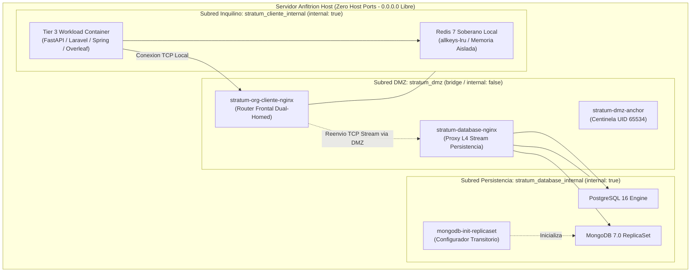
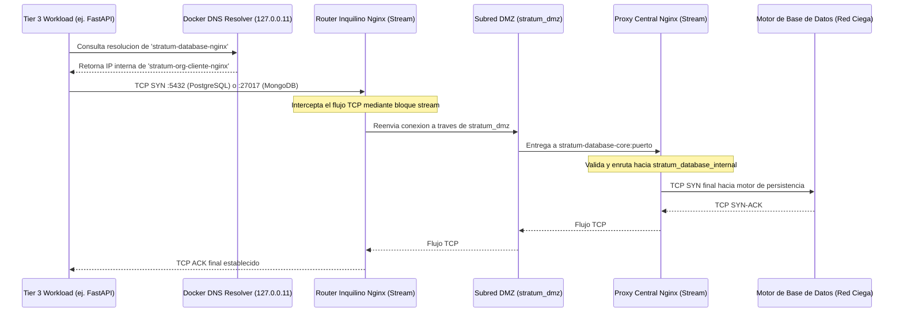

# Stratum Sovereign Architecture Specification

> **Documento de Especificacion Tecnica Oficial y Registro Arquitectonico**  
> *Version 2.0.0 — Isora Cloud Group (ICG)*  
> *Autora y Titular: Sandra Gabriela Puerto Torres (SGPT) ([GitHub: @sandra-puerto](https://github.com/sandra-puerto) · [LinkedIn](https://www.linkedin.com/in/sandra-puerto/)) — Protegido conforme a la Ley 23 de 1982 y Decisión Andina 351 (DNDA Colombia)*

---

## 1. Topologia de Red y Enrutamiento Split-Horizon

Stratum implementa un modelo de aislamiento donde ningun servicio de aplicacion conoce la direccion de red real ni tiene ruta IP directa hacia los motores centrales de base de datos.

### 1.1. Diagrama de Confinamiento Topologico de Red



### 1.2. Flujo Secuencial de Paquetes en Persistencia (Split-Horizon)



---

## 2. Definicion Formal de Subredes y Aislamiento

Conforme al **ADR-0001** y **ADR-0002**, el aislamiento se basa en espacios de nombres de red de Linux (*network namespaces*) administrados por Docker:

| Nombre de Red | Ambito | Driver | Bandera `internal` | Conectividad Externa y Politica de Enrutamiento |
| :--- | :--- | :--- | :---: | :--- |
| **`stratum_dmz`** | Plataforma Central | `bridge` | `false` | Solo trafico saliente hacia tuneles Ingress autorizados (Cloudflare Zero Trust). Cero puertos de escucha abiertos en `0.0.0.0`. |
| **`stratum_database_internal`** | Nucleo Persistencia | `bridge` | **`true`** | **Red Ciega.** Sin puerta de enlace predeterminada hacia internet. Imposibilidad fisica y logica de exfiltracion. |
| **`stratum_<org>_internal`** | Isla de Inquilino | `bridge` | **`true`** | **Red Ciega.** Confinada al perimetro exclusivo de la organizacion. Imposibilidad de enrutar hacia otras islas. |

---

## 3. Mecanismos Avanzados de Ingenieria

### 3.1. Reconfiguracion Automatica de Replica MongoDB
En topologias donde MongoDB opera dentro de una subred ciega y se consume a traves de proxies TCP de Capa 4, el protocolo nativo de MongoDB falla al devolver a los clientes la direccion interna del contenedor (`mongo:27017`), la cual es inalcanzable desde las redes de los inquilinos.

Stratum resuelve este desafio mediante el contenedor transitorio `mongodb-init-replicaset`, el cual ejecuta un script de inicializacion que reconfigura el replica set anunciando la direccion del proxy L4:
```javascript
rs.reconfig({
  _id: "rs0",
  members: [{ _id: 0, host: "stratum-database-nginx:27017" }]
}, { force: true });
```
Esto garantiza compatibilidad transparente para controladores cliente de Node.js, Python, Java y PHP sin requerir acceso de red directo al contenedor primario.

### 3.2. Cosecha de Entropia Fisica Multicapa (`entropy.py`)
El generador criptografico integrado en `stratum-cli` erradica el riesgo de colision de claves o generacion determinista en entornos virtualizados. El algoritmo combina:
1. CSPRNG nativo del sistema operativo (`os.urandom` / `secrets`).
2. Jitter y fluctuaciones de micro-temporizacion del reloj de la CPU en nanosegundos (`time.perf_counter_ns()`).
3. Variabilidad del espacio de memoria (direcciones de objetos en memoria dinamica afectadas por ASLR).
4. Compresion criptografica en esponja mediante **HMAC-SHA512**, produciendo cadenas aleatorias alfanumericas de alta densidad.

### 3.3. Enrutamiento Atomico L7 y Prevencion de Inyeccion
Las rutas perimetrales generadas dinamicamente para cada inquilino se gestionan bajo un ciclo transaccional:
1. Generacion del bloque de configuracion Nginx asignando el upstream a variables en tiempo de ejecucion.
2. Comprobacion sintactica aislada en el contenedor:
   ```bash
   docker exec stratum-org-<org>-nginx nginx -t
   ```
3. Si la prueba falla, el sistema ejecuta un rollback inmediato restaurando el archivo previo sin interrumpir el servicio activo.
4. Aplicacion en caliente sin caida de conexiones activas:
   ```bash
   docker exec stratum-org-<org>-nginx nginx -s reload
   ```

### 3.4. Auditoria Preventiva del Sistema (`stratum doctor`)
El plano de control implementa una rutina de diagnostico en 10 puntos de control:
* Existencia y permisos del socket `/var/run/docker.sock`.
* Parametro del kernel `vm.overcommit_memory = 1` (requerido para estabilidad de Redis).
* Permisos de solo lectura (`chmod 600`) en archivos de variables de entorno `.env`.
* Verificacion de la directiva `internal: true` en todas las redes de persistencia y de inquilino.
* Verificacion de ausencia de directivas `ports:` abiertas al host fisico.
* Estado de salud y conectividad de `stratum-dmz-anchor`.

---

## 4. Contratos de Contenedores y Estandar de Ejecucion

Todos los contenedores de la suite deben respetar estrictamente las directivas de seguridad en sus descriptores Docker Compose:

1. **PID 1 Supervisado:** Uso obligatorio de `tini` o `init: true` para recolectar procesos zombies derivados de ejecuciones de scripts o compiladores.
2. **Capacidades Minimas del Kernel:** `cap_drop: [ALL]`. Queda vetado el uso de contenedores en modo privilegiado (`privileged: true`).
3. **Bloqueo de Escalada:** `security_opt: ["no-new-privileges:true"]`.
4. **Sistemas de Archivos Inmutables:** Sistema de archivos raiz en modo lectura (`read_only: true`). Todos los directorios volatiles (`/tmp`, `/run`) se montan exclusivamente sobre memoria RAM (`tmpfs`).
5. **Usuarios No Privilegiados:** Todo proceso de aplicacion corre bajo UIDs especificos (ej. `appuser`, `node`, `spring`, `www-data`, `nobody`).
