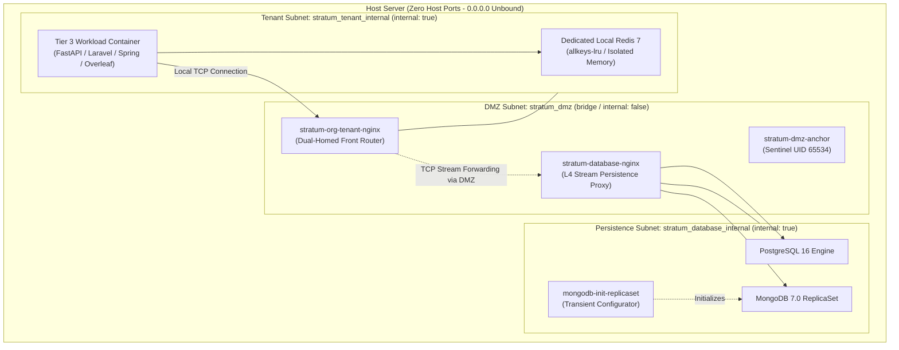
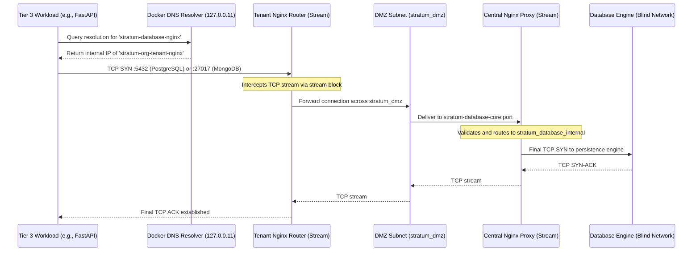
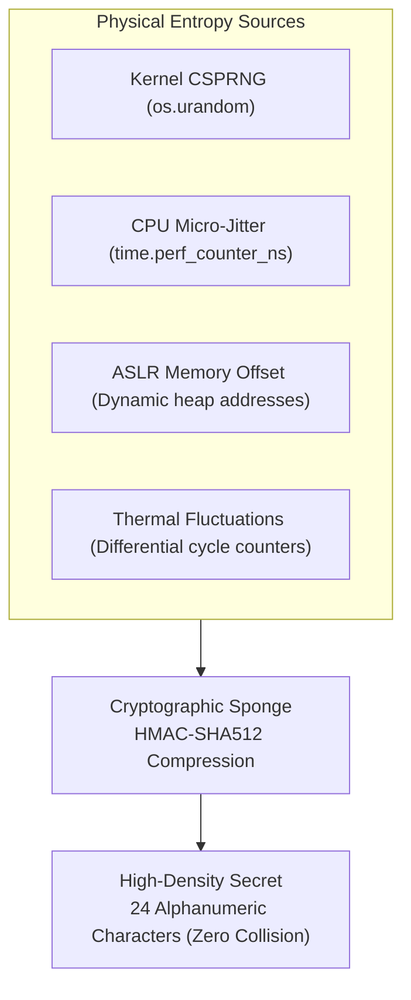
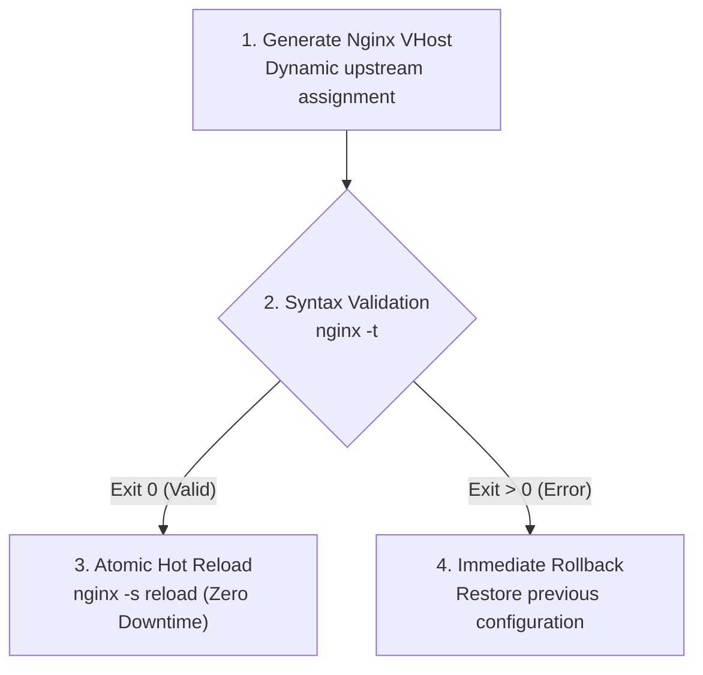

# Stratum Sovereign Architecture Specification

> **Official Technical Specification and Architectural Reference**  
> *Version 2.0.0 — Isora Cloud Group (ICG)*  
> *Architect & Copyright Holder: Sandra Gabriela Puerto Torres (SGPT) ([GitHub: @sandra-puerto](https://github.com/sandra-puerto) · [LinkedIn](https://www.linkedin.com/in/sandra-puerto/)) — Unpublished Scientific and Technical Work registered under Law 23 of 1982 and Andean Decision 351 (DNDA Colombia)*

---

## 1. Network Topology and Split-Horizon Routing

Stratum implements an isolation model where application services have no knowledge of the real network address and possess no direct IP route to central database engines.

### 1.1. Topological Network Confinement Diagram



### 1.2. Sequential Packet Flow in Persistence (Split-Horizon)



---

## 2. Formal Subnet and Isolation Specification

Pursuant to **ADR-0001** and **ADR-0002**, isolation is enforced through Linux network namespaces managed by Docker:

| Network Name | Scope | Driver | `internal` Flag | External Connectivity and Routing Policy |
| :--- | :--- | :--- | :---: | :--- |
| **`stratum_dmz`** | Central Platform | `bridge` | `false` | Outbound traffic restricted to authorized ingress tunnels (Cloudflare Zero Trust). Zero listening ports bound on `0.0.0.0`. |
| **`stratum_database_internal`** | Persistence Core | `bridge` | **`true`** | **Blind Network.** No default egress gateway to the internet. Physical and logical prevention of data exfiltration. |
| **`stratum_<org>_internal`** | Tenant Island | `bridge` | **`true`** | **Blind Network.** Confined exclusively to the tenant perimeter. Cross-island packet routing is prohibited. |

---

## 3. Engineering Mechanisms

### 3.1. Automated MongoDB Replica Set Reconfiguration
When MongoDB operates within a blind subnet and is accessed through Layer-4 TCP stream proxies, its native protocol fails by returning the container internal address (`mongo:27017`) to clients, which is unreachable from tenant subnets.

Stratum resolves this constraint using the transient initialization container `mongodb-init-replicaset`, which executes a reconfiguration script announcing the L4 proxy address:

```javascript
rs.reconfig({
  _id: "rs0",
  members: [{ _id: 0, host: "stratum-database-nginx:27017" }]
}, { force: true });
```

This guarantees transparent client driver compatibility across Node.js, Python, Java, and PHP runtimes without requiring direct network exposure to the primary database container.

### 3.2. Multi-Source Physical Entropy Harvesting (`entropy.py`)
The cryptographic entropy generator built into `stratum-cli` mitigates key collision and deterministic pseudorandom generation in virtualized environments. The algorithm samples four independent physical entropy sources:



1. Operating system native CSPRNG (`os.urandom` / `secrets`).
2. CPU nanosecond clock micro-jitter and timing variations (`time.perf_counter_ns()`).
3. Memory address space layout randomization (ASLR dynamic object addresses).
4. Cryptographic sponge compression using **HMAC-SHA512**, generating high-density alphanumeric secrets.

### 3.3. Atomic L7 Routing and Injection Prevention
Perimeter routing rules generated dynamically for each tenant are managed under a transactional cycle protected against syntax regressions:



1. Generation of the Nginx configuration block assigning upstream hosts to runtime variables.
2. Isolated syntax verification within the running container:
   ```bash
   docker exec stratum-org-<org>-nginx nginx -t
   ```
3. If verification fails, an immediate rollback restores the previous configuration without service interruption.
4. Hot configuration reload with zero connection downtime:
   ```bash
   docker exec stratum-org-<org>-nginx nginx -s reload
   ```

### 3.4. Preventive System Health Audit (`stratum doctor`)
The administrative control plane implements a diagnostic routine covering 10 inspection checkpoints:
* Verification of `/var/run/docker.sock` existence and permissions.
* Kernel parameter `vm.overcommit_memory = 1` enforcement (required for Redis memory allocation).
* Read-only file permissions (`chmod 600`) on `.env` environment files.
* Verification of `internal: true` flags across all persistence and tenant subnets.
* Absence of `ports:` directives bound directly to physical host interfaces.
* Health state and connectivity of `stratum-dmz-anchor`.

---

## 4. Container Execution Standards and Security Directives

All containers within the Stratum suite adhere strictly to the following security directives in Docker Compose descriptors:

1. **Supervised PID 1:** Mandatory use of `tini` or `init: true` to prevent orphan zombie processes generated by script or compiler executions.
2. **Kernel Capability Dropping:** Mandatory `cap_drop: [ALL]`. Privileged container mode (`privileged: true`) is prohibited.
3. **Privilege Escalation Prevention:** Enforced `security_opt: ["no-new-privileges:true"]`.
4. **Immutable Root Filesystems:** Root filesystems configured in read-only mode (`read_only: true`). All volatile directories (`/tmp`, `/run`) are mounted strictly in RAM via `tmpfs`.
5. **Non-Root Execution:** All application processes run under dedicated unprivileged UIDs (e.g., `appuser`, `node`, `spring`, `www-data`, `nobody`).
