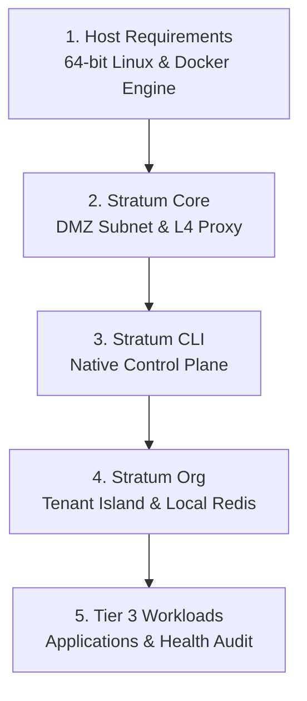

# Deployment and Operations Guide: Stratum Platform

> Step-by-step procedure for deploying and operating the **Stratum Sovereign Multi-Tenant** architecture on bare-metal Linux servers or dedicated instances.



Quick navigation by stage:
* [1. Host Server Prerequisites](#1-host-server-prerequisites)
* [2. Phase 1: Base Platform Deployment (Stratum Core)](#2-phase-1-base-platform-deployment-stratum-core)
* [3. Phase 2: Control Plane Configuration (Stratum CLI)](#3-phase-2-control-plane-configuration-stratum-cli)
* [4. Phase 3: Tenant Island Provisioning (Stratum Org)](#4-phase-3-tenant-island-provisioning-stratum-org)
* [5. Phase 4: Workload Deployment (Tier 3 Workloads)](#5-phase-4-workload-deployment-tier-3-workloads)
* [6. Phase 5: Isolation Verification and Audit](#6-phase-5-isolation-verification-and-audit)

---

## 1. Host Server Prerequisites

Before initiating deployment, verify that the host server satisfies the minimum baseline:

* **Operating System:** 64-bit Linux distribution (Debian 12+, Ubuntu 22.04 LTS / 24.04 LTS, Rocky Linux 9+).
* **Container Engine:** Docker Engine 24.0+ and Docker Compose Plugin v2.20+.
* **Runtime Environment:** Python 3.10+ (required exclusively for executing `stratum-cli`).
* **Kernel & Networking:** Linux cgroups v2 support, active `bridge` module, and `net.ipv4.ip_forward=1` enabled.
* **Security Invariant:** Zero services listening on public ports 80, 443, or database ports bound to physical host interfaces (`0.0.0.0`).

---

## 2. Phase 1: Base Platform Deployment (Stratum Core)

Perimeter ingress infrastructure and the central persistence cluster reside in the [`stratum-core`](https://github.com/isora-cloud-group/stratum-core) repository.

### 2.1. Repository Clone and Directory Layout
```bash
git clone https://github.com/isora-cloud-group/stratum-core.git /opt/stratum-core
cd /opt/stratum-core
```

### 2.2. Initialize DMZ Subnet and Sentinel Anchor
The `stratum_dmz` network serves as the intermediary channel between external ingress gateways and tenant front routers.
```bash
cd /opt/stratum-core/dmz
docker compose up -d
```
Verify that the `stratum-dmz-anchor` container is running under unprivileged user `nobody` (UID 65534):
```bash
docker compose ps
```

### 2.3. Initialize Persistence Cluster and L4 Proxy
The persistence subsystem (`database/`) deploys PostgreSQL 16 and MongoDB 7.0 on the blind network `stratum_database_internal`, exposing virtual stream ports exclusively to the DMZ via the Nginx L4 proxy.
```bash
cd /opt/stratum-core/database
cp .env.example .env
# Configure master credentials and administrative environment variables
docker compose up -d
```

Verify that the persistence network is configured as strictly blind (`internal: true`):
```bash
docker network inspect stratum_database_internal --format '{{.Internal}}'
# Expected output: true
```

---

## 3. Phase 2: Control Plane Configuration (Stratum CLI)

[`stratum-cli`](https://github.com/isora-cloud-group/stratum-cli) requires zero third-party dependencies; it operates natively using the Python standard library.

### 3.1. Local Installation
```bash
git clone https://github.com/isora-cloud-group/stratum-cli.git /opt/stratum-cli
cd /opt/stratum-cli
chmod +x install.sh
sudo ./install.sh
```

### 3.2. Diagnostic Health Check (`stratum doctor`)
Execute system diagnostics to verify daemons, subnets, and security invariants:
```bash
stratum doctor
```

---

## 4. Phase 3: Tenant Island Provisioning (Stratum Org)

Each tenant organization operates within a dedicated sovereign perimeter provisioned by [`stratum-org`](https://github.com/isora-cloud-group/stratum-org).

### 4.1. Provision Tenant via CLI
To provision a tenant identified as `enterprise-alpha`:
```bash
stratum org create enterprise-alpha
```
This automated command performs:
1. Identifier format validation against the deterministic pattern `^[a-z0-9]+(?:-[a-z0-9]+)*$`.
2. Creation of the private tenant bridge network `stratum_enterprise-alpha_internal` (`internal: true`).
3. Internal certificate generation and Nginx configuration with split-horizon routing.
4. Cryptographic secret generation using the HMAC-SHA512 physical entropy sponge.
5. Deployment of the dedicated local Redis 7 container and dual-homed front router.

### 4.2. Provision Tenant Database Schemas
```bash
stratum db create enterprise-alpha --type postgres
```
This command initializes the restricted schema and user on central PostgreSQL, granting access exclusively to `db_enterprise_alpha` under least privilege.

---

## 5. Phase 4: Workload Deployment (Tier 3 Workloads)

Tenant workloads deploy using official boilerplate repositories corresponding to the required runtime.

### 5.1. Example: Python Backend Deployment (FastAPI)
```bash
git clone https://github.com/isora-cloud-group/stratum-python.git /opt/workloads/enterprise-alpha-api
cd /opt/workloads/enterprise-alpha-api
cp .env.example .env
```

Configure `.env` binding the workload to the tenant island:
```env
TENANT_ORG=enterprise-alpha
APP_PORT=8000
DB_HOST=stratum-database-nginx
DB_PORT=5432
DB_NAME=db_enterprise_alpha
DB_USER=usr_enterprise_alpha
DB_PASSWORD=<cli_generated_secret>
REDIS_HOST=redis
REDIS_PORT=6379
```

Start the workload:
```bash
docker compose up -d --build
```

---

## 6. Phase 5: Isolation Verification and Audit

Validate that network isolation invariants hold across all perimeters:

1. **Verify Database Internet Isolation (Must Fail):**
   ```bash
   docker exec -it stratum-database-core-postgres ping -c 2 1.1.1.1 || echo "Isolation verified: Blind network without internet egress"
   ```

2. **Verify Inter-Tenant Confinement (Must Fail):**
   Attempt connection from `enterprise-alpha` workload to `enterprise-beta` network:
   ```bash
   docker exec -it stratum-enterprise-alpha-api ping -c 2 stratum-org-enterprise-beta-nginx || echo "Isolation verified: Neighboring tenant unreachable"
   ```

3. **Verify Host Port Bindings:**
   Confirm zero listening application ports on the host physical interfaces:
   ```bash
   sudo ss -tulpn | grep -E ':(5432|27017|6379|8000|8080)'
   # Expected output: completely empty
   ```
