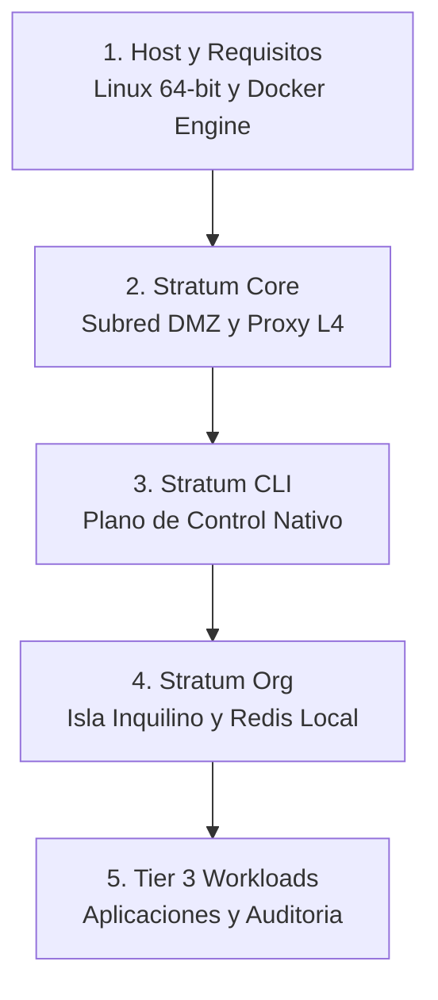

# Guia de Operacion y Despliegue: Stratum Platform

> Procedimiento paso a paso para desplegar y operar la arquitectura **Stratum Sovereign Multi-Tenant** en servidores Linux bare-metal o instancias dedicadas.



Acceso rapido por etapa:
* [Requisitos Previos del Servidor Host](#1-requisitos-previos-del-servidor-host)
* [Fase 1: Despliegue de la Plataforma Base (Stratum Core)](#2-fase-1-despliegue-de-la-plataforma-base-stratum-core)
* [Fase 2: Configuracion del Plano de Control (Stratum CLI)](#3-fase-2-configuracion-del-plano-de-control-stratum-cli)
* [Fase 3: Aprovisionamiento de una Isla de Organizacion (Stratum Org)](#4-fase-3-aprovisionamiento-de-una-isla-de-organizacion-stratum-org)
* [Fase 4: Despliegue de Cargas de Trabajo (Tier 3 Workloads)](#5-fase-4-despliegue-de-cargas-de-trabajo-tier-3-workloads)
* [Fase 5: Verificacion y Auditoria de Aislamiento](#6-fase-5-verificacion-y-auditoria-de-aislamiento)

---

## 1. Requisitos Previos del Servidor Host

Antes de iniciar la instalacion, asegurese de que el host cumple con los requerimientos minimos:

* **Sistema Operativo:** Linux de 64 bits (Debian 12+, Ubuntu 22.04 LTS / 24.04 LTS, Rocky Linux 9+).
* **Motor de Contenedores:** Docker Engine 24.0+ y Docker Compose Plugin v2.20+.
* **Entorno de Administracion:** Python 3.10+ (requerido unicamente para ejecutar `stratum-cli`).
* **Kernel & Red:** Soporte para cgroups v2, modulo `bridge` activo y directivas `net.ipv4.ip_forward=1`.
* **Regla Fundamental:** Cero servicios escuchando en los puertos publicos 80, 443 o puertos de base de datos directamente sobre las interfaces fisicas del servidor.

---

## 2. Fase 1: Despliegue de la Plataforma Base (Stratum Core)

La infraestructura perimetral y el clúster de persistencia residen en el repositorio [`stratum-core`](https://github.com/isora-cloud-group/stratum-core).

### 2.1. Clonacion y Estructura
```bash
git clone https://github.com/isora-cloud-group/stratum-core.git /opt/stratum-core
cd /opt/stratum-core
```

### 2.2. Inicializar la Red DMZ y Centinela
La red `stratum_dmz` sirve como canal intermedio de conexion entre el gateway exterior y los routers frontales de cada inquilino.
```bash
cd /opt/stratum-core/dmz
docker compose up -d
```
Verifique que el contenedor `stratum-dmz-anchor` se encuentre activo bajo el usuario no root `nobody`:
```bash
docker compose ps
```

### 2.3. Inicializar la Capa de Persistencia y Proxy L4
El subsistema de persistencia (`database/`) levanta PostgreSQL 16 y MongoDB 7.0 sobre la red ciega `stratum_database_internal`, exponiendo unicamente los puertos virtuales hacia la DMZ mediante el proxy TCP Stream de Nginx.
```bash
cd /opt/stratum-core/database
cp .env.example .env
# Configure contraseñas maestras y variables administrativas
docker compose up -d
```

Verifique que la red interna sea estrictamente ciega (`internal: true`):
```bash
docker network inspect stratum_database_internal --format '{{.Internal}}'
# Salida esperada: true
```

---

## 3. Fase 2: Configuracion del Plano de Control (Stratum CLI)

[`stratum-cli`](https://github.com/isora-cloud-group/stratum-cli) no requiere dependencias de terceros; funciona de forma nativa utilizando la biblioteca estandar de Python.

### 3.1. Instalacion Local
```bash
git clone https://github.com/isora-cloud-group/stratum-cli.git /opt/stratum-cli
cd /opt/stratum-cli
chmod +x install.sh
sudo ./install.sh
```

### 3.2. Diagnostico del Sistema (Health Check)
Ejecute el comando de diagnostico para comprobar que los demonios, subredes e invariantes de seguridad estan activos:
```bash
stratum doctor
```

---

## 4. Fase 3: Aprovisionamiento de una Isla de Organizacion (Stratum Org)

Cada cliente u organizacion opera dentro de su propio perímetro sovereign materializado por [`stratum-org`](https://github.com/isora-cloud-group/stratum-org).

### 4.1. Crear una Organizacion via CLI
Para aprovisionar la organizacion `empresa-alfa`:
```bash
stratum org create empresa-alfa
```
Este comando ejecuta automaticamente:
1. Validacion del identificador contra la expresion determinista `^[a-z0-9]+(?:-[a-z0-9]+)*$`.
2. Creacion de la subred privada `stratum_empresa-alfa_internal` (`internal: true`).
3. Generacion de certificados internos y configuracion de Nginx con reenvio split-horizon.
4. Generacion de secretos criptograficos mediante la esponja de entropia fisica HMAC-SHA512.
5. Despliegue del contenedor Redis 7 local dedicado y el router frontal dual-homed.

### 4.2. Aprovisionar Base de Datos para la Organizacion
```bash
stratum db create empresa-alfa --type postgres
```
Este comando crea el esquema y usuario restringido en PostgreSQL central, concediendo acceso unicamente a la base de datos `db_empresa_alfa` con minimos privilegios.

---

## 5. Fase 4: Despliegue de Cargas de Trabajo (Tier 3 Workloads)

Las aplicaciones cliente se despliegan utilizando los repositorios de plantilla correspondientes al lenguaje deseado.

### 5.1. Ejemplo: Despliegue de Backend Python (FastAPI)
```bash
git clone https://github.com/isora-cloud-group/stratum-python.git /opt/workloads/empresa-alfa-api
cd /opt/workloads/empresa-alfa-api
cp .env.example .env
```

Configure el archivo `.env` vinculando la carga a la organizacion:
```env
TENANT_ORG=empresa-alfa
APP_PORT=8000
DB_HOST=stratum-database-nginx
DB_PORT=5432
DB_NAME=db_empresa_alfa
DB_USER=usr_empresa_alfa
DB_PASSWORD=<secreto_generado_por_cli>
REDIS_HOST=redis
REDIS_PORT=6379
```

Inicie el servicio:
```bash
docker compose up -d --build
```

---

## 6. Fase 5: Verificacion y Auditoria de Aislamiento

Compruebe que el aislamiento de red por diseno es efectivo:

1. **Intento de Acceso a Internet desde la Base de Datos (Debe Fallar):**
   ```bash
   docker exec -it stratum-database-core-postgres ping -c 2 1.1.1.1 || echo "Aislamiento verificado: Red ciega sin egress"
   ```

2. **Intento de Comunicacion Inter-Tenant (Debe Fallar):**
   Intentar conectarse desde la carga de trabajo de `empresa-alfa` hacia la red de `empresa-beta`:
   ```bash
   docker exec -it stratum-empresa-alfa-api ping -c 2 stratum-org-empresa-beta-nginx || echo "Aislamiento verificado: Imposible resolver o alcanzar inquilino adyacente"
   ```

3. **Verificacion de Puertos en el Host:**
   Compruebe con `ss` o `netstat` que el host fisico no tiene puertos de servicio abiertos:
   ```bash
   sudo ss -tulpn | grep -E ':(5432|27017|6379|8000|8080)'
   # La salida debe ser completamente nula.
   ```

