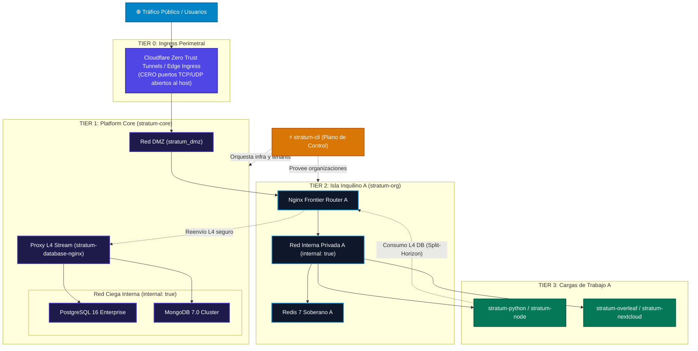

<div align="center">

# 🌐 STRATUM SOVEREIGN MULTI-TENANT ARCHITECTURE
## Master Architecture Hub & Component Directory

[](https://isora.com.co)
[-f59e0b?style=for-the-badge&logo=shield&logoColor=white)](https://www.linkedin.com/in/sandra-puerto/)
[](https://github.com/sandra-puerto)
[](#)
[](SECURITY.md)
[](LICENSE)

### *"Aislamiento por diseño, no por disciplina"*
*(“Isolation by design, not by discipline”)*

---

[**Visión y Filosofía**](#1-visión-y-filosofía) •
[**Directorio de Componentes (Guía Telefónica)**](#2-directorio-general-de-componentes) •
[**Topología en 4 Capas**](#3-arquitectura-y-topología-en-4-capas) •
[**Guía de Decisión**](#4-árbol-de-decisión-por-dónde-empiezo) •
[**Cumplimiento y Hardening**](#5-matriz-de-seguridad-y-cumplimiento)

---
</div>

## 1. Visión y Filosofía

**Stratum** es una suite de herramientas y arquitectura de referencia de grado empresarial diseñada para operar múltiples organizaciones (inquilinos / *tenants*) sobre una misma infraestructura física o virtual, garantizando un aislamiento estricto a nivel de kernel, red y persistencia.

### El Reto del Multi-Tenancy Tradicional
* **El fallo del aislamiento lógico en base de datos:** Confiar en una columna `tenant_id` y en que los desarrolladores nunca olviden una cláusula `WHERE` es una bomba de tiempo operativa. Un descuido humano expone datos confidenciales entre empresas.
* **El peligro de puertos abiertos:** Mapear puertos al host (`-p 8080:80`, `-p 5432:5432`) provoca colisiones y expone motores de persistencia a la red pública o a movimientos laterales entre contenedores.
* **La sobrecarga de Kubernetes:** Orquestar clústeres sobredimensionados para albergar entre 2 y 50 organizaciones introduce costos desorbitados y complejidad innecesaria.

### El Enfoque Stratum
Stratum elimina la dependencia de la disciplina humana implementando restricciones infranqueables por diseño:
1. **Zero Host Ports:** Ningún contenedor de servicio publica puertos hacia interfaces físicas del host.
2. **Redes Ciegas (`internal: true`):** Las bases de datos y cargas internas no poseen pasarela de salida a internet; la exfiltración directa es imposible.
3. **Persistencia Mediada en L4 (Split-Horizon):** Los motores de base de datos residen en una red aislada y solo son accesibles mediante proxies TCP stream controlados.
4. **Redis Soberano Local:** Cada inquilino dispone de su propia instancia de Redis; la memoria volátil y las sesiones nunca se comparten.

---

## 2. Directorio General de Componentes

Utiliza esta guía como punto de aterrizaje para explorar y clonar los módulos de la suite:

### 🎮 Plano de Control y Orquestación

| Repositorio | Rol Arquitectónico | Tecnologías Clave | Enlace al Repositorio |
| :--- | :--- | :--- | :--- |
| **`stratum-cli`** | **Orquestador Central de CLI**<br>Aprovisionamiento de inquilinos, rotación criptográfica con entropía física, validaciones y diagnósticos (`stratum doctor`). **Cero dependencias externas de runtime.** | Python 3.10+ (Standard Library pura), HMAC-SHA512, Linux CLI | [](https://github.com/sandra-puerto/stratum-cli) |

---

### 🏛️ Plano de Plataforma y Frontera de Inquilino

| Repositorio | Rol Arquitectónico | Tecnologías Clave | Enlace al Repositorio |
| :--- | :--- | :--- | :--- |
| **`stratum-core`** | **Tier 1: Cimientos de Plataforma**<br>Define la DMZ perimetral, el gateway de entrada de túneles y el clúster central de persistencia (PostgreSQL 16, MongoDB 7) confinado en red ciega con proxy L4. | Docker Compose, Nginx Stream L4, Cloudflare Tunnels, Postgres, Mongo | [](https://github.com/sandra-puerto/stratum-core) |
| **`stratum-org`** | **Tier 2: Isla Soberana de Organización**<br>Frontera administrativa y de red para un cliente individual. Enrutador dual-homed, red interna privada aislada y Redis 7 dedicado. | Nginx L7/L4, Redis 7, Docker Compose, Split-Horizon | [](https://github.com/sandra-puerto/stratum-org) |

---

### 🚀 Cargas de Trabajo Consumidoras (Tier 3 Workloads)
*Plantillas reforzadas listas para producción. Conectadas exclusivamente a la red interna de su organización y sin exposición de puertos al host.*

| Repositorio | Stack Tecnológico | Casos de Uso Típicos | Enlace al Repositorio |
| :--- | :--- | :--- | :--- |
| **`stratum-python`** | Python 3.12+, FastAPI, Django, Celery | Microservicios REST/GraphQL de alto rendimiento, APIs asíncronas y colas de tareas con Celery. | [](https://github.com/sandra-puerto/stratum-python) |
| **`stratum-node`** | Node.js 20/22+ LTS, TypeScript, NestJS, Express | Aplicaciones en tiempo real, backends TypeScript modulares y APIs orientadas a eventos. | [](https://github.com/sandra-puerto/stratum-node) |
| **`stratum-spring`** | Java 21 LTS, Spring Boot 3.3+, Gradle/Maven | Servicios transaccionales empresariales, arquitecturas DDD y procesamiento batch robusto. | [](https://github.com/sandra-puerto/stratum-spring) |
| **`stratum-laravel`** | PHP 8.4/8.5, Laravel 11/12+, FrankenPHP/Nginx | Aplicaciones web completas, SaaS administrativos, sistemas CRM/ERP y flujos de trabajo PHP modernos. | [](https://github.com/sandra-puerto/stratum-laravel) |
| **`stratum-overleaf`** | Overleaf CE, TeX Live 2026 Scheme-Full, Redis, Mongo | Estudio colaborativo de redacción científica LaTeX con compilación acelerada en memoria `tmpfs`. | [](https://github.com/sandra-puerto/stratum-overleaf) |
| **`stratum-nextcloud`** | Nextcloud Hub Enterprise, PHP 8.3+, MariaDB/Postgres | Suite colaborativa de nube soberana, almacenamiento privado de archivos, sincronización y ofimática. | [](https://github.com/sandra-puerto/stratum-nextcloud) |

---

## 3. Arquitectura y Topología en 4 Capas



---

## 4. Árbol de Decisión: ¿Por dónde empiezo?

```
¿Qué deseas lograr en la plataforma Stratum?
│
├── 1. "Voy a montar la infraestructura base por primera vez"
│   └── ➔ Despliega [stratum-core](https://github.com/sandra-puerto/stratum-core)
│          (Configura DMZ, túneles de entrada y base de datos central).
│
├── 2. "Necesito aprovisionar un nuevo cliente / inquilino"
│   └── ➔ Ejecuta [stratum-cli](https://github.com/sandra-puerto/stratum-cli)
│          Comando: `stratum org create <nombre-cliente>`
│          (Genera la isla basada en [stratum-org](https://github.com/sandra-puerto/stratum-org)).
│
└── 3. "Quiero desarrollar o migrar una aplicación para un cliente"
    ├── Backend Python (FastAPI/Django)  ➔ [stratum-python](https://github.com/sandra-puerto/stratum-python)
    ├── Backend TypeScript / Node.js     ➔ [stratum-node](https://github.com/sandra-puerto/stratum-node)
    ├── Backend Java / Spring Boot       ➔ [stratum-spring](https://github.com/sandra-puerto/stratum-spring)
    ├── Aplicación PHP / Laravel         ➔ [stratum-laravel](https://github.com/sandra-puerto/stratum-laravel)
    ├── Suite Colaborativa LaTeX         ➔ [stratum-overleaf](https://github.com/sandra-puerto/stratum-overleaf)
    └── Almacenamiento y Nube Soberana   ➔ [stratum-nextcloud](https://github.com/sandra-puerto/stratum-nextcloud)
```

---

## 5. Matriz de Seguridad y Cumplimiento

Todos los contenedores de la suite Stratum deben cumplir estrictamente con los siguientes estándares:

| Control Técnico | Estándar Stratum | Impacto en Cumplimiento (ISO 27001 / SOC 2) |
| :--- | :--- | :--- |
| **Capacidades Linux** | `cap_drop: [ALL]` | Anula capacidades que permitirían alterar interfaces de red o escapar del contenedor. |
| **Restricción SUID/SGID** | `security_opt: [no-new-privileges:true]` | Bloquea técnicas comunes de elevación local de privilegios. |
| **Usuario de Ejecución** | Usuarios sin privilegios (`appuser`, `node`, `spring`, `nobody`) | Mitiga riesgos de vulneración total del host en caso de RCE. |
| **Aislamiento de Red** | Redes internas con bandera `internal: true` | Impide que bases de datos o microservicios realicen conexiones no autorizadas al exterior. |
| **Persistencia Volátil** | `read_only: true` con directorios temporales en `tmpfs` | Erradica la persistencia de malware en el sistema de archivos del contenedor. |
| **Supervisión de Procesos** | Inicializador `tini` / `init: true` | Previene procesos zombi y garantiza respuesta inmediata ante señales del sistema. |

---

## 6. Documentación Adicional

* 📖 [**Arquitectura Detallada (ARCHITECTURE.md)**](ARCHITECTURE.md): Explicación exhaustiva del modelo de enrutamiento split-horizon y niveles de red.
* 📋 [**Matriz de Compatibilidad (COMPATIBILITY_MATRIX.md)**](COMPATIBILITY_MATRIX.md): Versiones de lenguajes, frameworks y motores probados.
* 🚀 [**Guía de Inicio Rápido (GETTING_STARTED.md)**](GETTING_STARTED.md): Manual paso a paso para operadores y sysadmins.
* 🔒 [**Política de Seguridad (SECURITY.md)**](SECURITY.md): Directrices de divulgación coordinada y reporte de vulnerabilidades.

---

## 7. Créditos y Licencia

* **Arquitectura & Autoría:** [Sandra Gabriela Puerto Torres (SGPT)](https://www.linkedin.com/in/sandra-puerto/)
* **Distribución Oficial:** [Isora Cloud Group](https://isora.com.co)
* **Licencia:** Distribuido bajo la **Licencia Apache 2.0**. Consulta el archivo [LICENSE](LICENSE) para más detalles.
