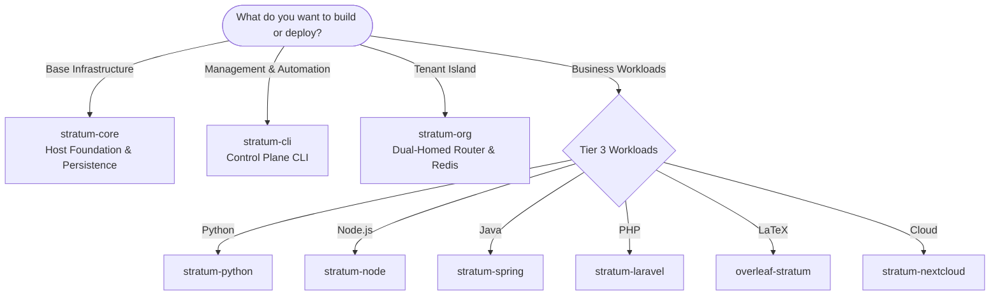
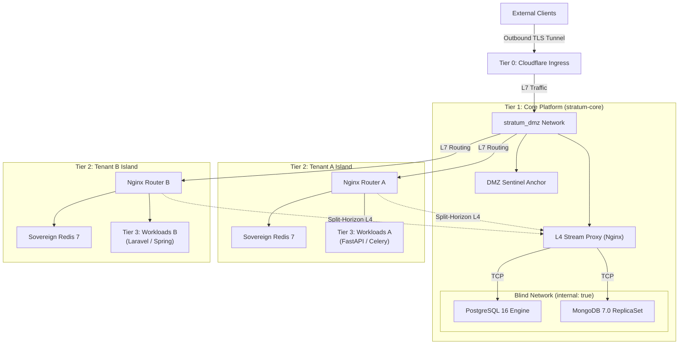
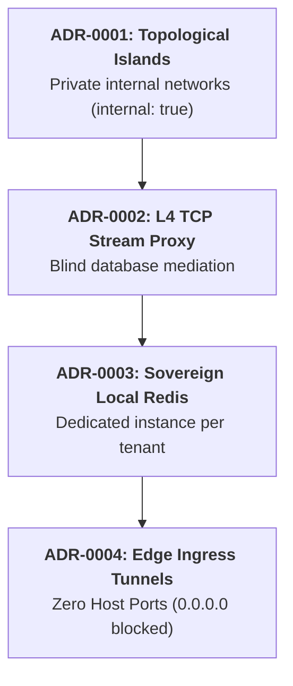
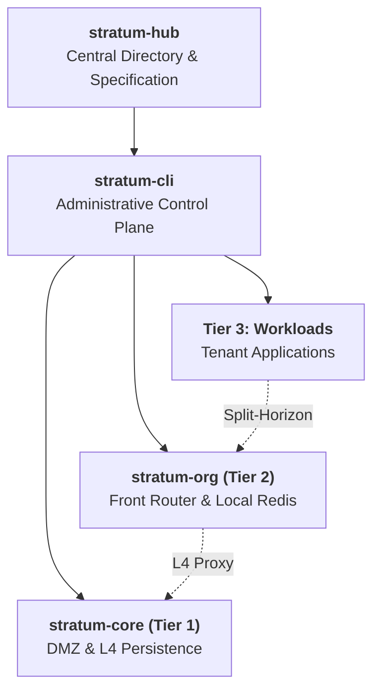

# Stratum
## Sovereign Multi-Tenant Architecture
### Master Component Directory · Infrastructure Suite with Isolation by Design

[-f59e0b?style=for-the-badge&logo=shield&logoColor=white)](https://www.linkedin.com/in/sandra-puerto/)

### *“Isolation by design, not by discipline”*

---

[1. Executive Summary](#1-executive-summary) · [2. Getting Started](#2-getting-started) · [3. Four-Tier Topology](#3-four-tier-topology) · [4. Repositories](#4-repository-directory) · [5. ADRs](#5-architectural-decision-records-adrs) · [6. Threat Model & Compliance](#6-threat-model-and-compliance) · [7. Module Hierarchy](#7-module-hierarchy) · [8. Enterprise Adoption](#8-enterprise-adoption-and-support) · [9. Governance](#9-authorship-governance-and-license)

---

## 1. Executive Summary

Stratum is a sovereign reference architecture and container engineering suite designed to operate multiple independent organizations on shared physical or virtual infrastructure. It is built upon three foundational pillars: **topological network isolation by design**, **blind persistence mediation**, and an **autonomous administrative control plane**.

### Problems Addressed

* **Logical Multi-Tenancy in Databases:** Hosting multiple organizations within a shared database discriminated solely by `tenant_id` shifts systemic risk to every single query: a typo in an SQL statement, a faulty migration, or an ORM bug can cross-expose sensitive customer data. Stratum enforces isolation at the kernel level via Linux network namespaces. Separation does not rely on human diligence; it is an immutable constraint of the infrastructure itself.
* **Operational Overhead of Kubernetes:** For deployments managing between 2 and 50 organizations, a full Kubernetes cluster introduces prohibitive cloud costs and operational complexity that are rarely justified. Stratum provides dense, secure, and cost-effective multi-tenancy on standard Linux host environments.
* **Host Port Exposure:** Stratum strictly enforces the **Zero Host Ports** invariant: no container ever binds or publishes ports directly onto the host interface (`0.0.0.0`). All ingress traffic flows exclusively through outbound authenticated TLS tunnels (Cloudflare Zero Trust).

> **Intellectual Property:** Pursuant to **Law 23 of 1982** and **Andean Decision 351 of 1993**, Stratum is registered as an **Unpublished Scientific and Technical Work** with the **National Directorate of Copyright (DNDA)** of the Republic of Colombia. Conceived and designed by **Sandra Gabriela Puerto Torres (SGPT)**, commercially distributed by **Isora Cloud Group (ICG)**, and implemented via agentic engineering with **Google Antigravity AI** and **DeepSeek**.

---

## 2. Getting Started

The following decision tree guides component selection based on deployment goals:

### Direct Access by Use Case

| Objective | Component | Scope |
| :--- | :--- | :--- |
| **Perimeter Network & Persistence** | [stratum-core](https://github.com/isora-cloud-group/stratum-core) | DMZ network, Cloudflare ingress tunnels, and central persistence cluster (PostgreSQL 16 / MongoDB 7). |
| **Administration & Automation** | [stratum-cli](https://github.com/isora-cloud-group/stratum-cli) | Native Python orchestrator (`stratum org create`, `stratum db create`, `stratum doctor`). |
| **Per-Tenant Isolation** | [stratum-org](https://github.com/isora-cloud-group/stratum-org) | Sovereign island template with perimeter router and dedicated local Redis 7. |
| **Applications (Tier 3)** | [Python](https://github.com/isora-cloud-group/stratum-python) · [Node.js](https://github.com/isora-cloud-group/stratum-node) · [Java/Spring](https://github.com/isora-cloud-group/stratum-spring) · [PHP/Laravel](https://github.com/isora-cloud-group/stratum-laravel) · [LaTeX/Overleaf](https://github.com/isora-cloud-group/overleaf-stratum) · [Cloud/Nextcloud](https://github.com/isora-cloud-group/stratum-nextcloud) | Production workloads grouped by technology stack. |

---

## 3. Four-Tier Topology

---

## 4. Repository Directory

All suite modules are coordinated under the [Isora Cloud Group](https://github.com/isora-cloud-group) organization.

| Repository | Layer | Description | Status |
| :--- | :--- | :--- | :---: |
| [stratum-hub](https://github.com/isora-cloud-group/stratum-hub) | Central Directory | Institutional entry point: integration catalog, technical specifications, and ADRs. | Production |
| [stratum-core](https://github.com/isora-cloud-group/stratum-core) | Tier 1 · Core Platform | Perimeter infrastructure, DMZ subnet, L4 TCP persistence proxy, and blind database cluster. | v2.0.0 |
| [stratum-cli](https://github.com/isora-cloud-group/stratum-cli) | Control Plane | Pure Python CLI orchestrator with zero runtime dependencies for provisioning, key rotation, and health auditing. | v2.0.0 |
| [stratum-org](https://github.com/isora-cloud-group/stratum-org) | Tier 2 · Tenant Island | Sovereign isolation blueprint: dual-homed Nginx router and dedicated per-tenant Redis 7. | v1.1.0 |
| [stratum-laravel](https://github.com/isora-cloud-group/stratum-laravel) | Tier 3 · Workload | PHP 8.4 with Laravel 11/12+, FrankenPHP/Nginx, read-only root filesystems, and unprivileged execution. | v2.1.0 |
| [overleaf-stratum](https://github.com/isora-cloud-group/overleaf-stratum) | Tier 3 · Workload | Collaborative LaTeX studio with TeX Live 2026 Scheme-Full, tmpfs compilation, and cold-start mitigation. | v3.1.0 |
| [stratum-python](https://github.com/isora-cloud-group/stratum-python) | Tier 3 · Workload | Production boilerplate for Python 3.12+ (FastAPI, Django, Celery) with multi-stage hardening and blind DB access. | v1.0.0 |
| [stratum-node](https://github.com/isora-cloud-group/stratum-node) | Tier 3 · Workload | Production boilerplate for Node.js 20/22+ LTS (NestJS, Express, TypeScript) on Alpine Linux with tini process reaping. | v1.0.0 |
| [stratum-spring](https://github.com/isora-cloud-group/stratum-spring) | Tier 3 · Workload | Production boilerplate for Java 21 LTS and Spring Boot 3.3+ with container-optimized memory allocation (`MaxRAMPercentage`). | v1.0.0 |
| [stratum-nextcloud](https://github.com/isora-cloud-group/stratum-nextcloud) | Tier 3 · Workload | Sovereign multi-tenant collaboration and storage suite with isolated databases and per-tenant Redis caching. | v2.0.0 |

---

## 5. Architectural Decision Records (ADRs)

The Stratum architecture is formalized across four Architectural Decision Records (ADRs):

* **ADR-0001 · Topological Islands vs. Flat Bridges:** Each tenant operates on a dedicated virtual bridge network, `stratum_${TENANT_ORG}_internal`, with the `internal: true` directive. Tenant workloads have no interface in the DMZ and expose zero host ports, establishing strict isolation enforced by Linux network namespaces.
* **ADR-0002 · Layer-4 Proxy for Shared Persistence:** An Nginx edge proxy with the `stream` module (`stratum-database-nginx`) dynamically resolves upstream hosts via Docker's internal DNS (`127.0.0.11 valid=10s`) and pools connections (`proxy_timeout 1h`). As a result, database engines never attach to the DMZ network.
* **ADR-0003 · Sovereign Redis per Tenant:** Multi-tenant shared Redis instances with logical database indices are prohibited. Each customer receives a dedicated Redis container governed by strict security constraints:
  * Memory constrained to `--maxmemory 200mb` with an `allkeys-lru` eviction policy.
  * Critical administrative commands disabled: `CONFIG`, `MODULE`, `DEBUG`, and `SHUTDOWN`.
  * Immutable root filesystem (`read_only: true`).
* **ADR-0004 · Authenticated Edge Tunnels with Zero Exposed Ports:** Inbound ports on the host physical firewall are eliminated (`0.0.0.0`). Ingress is routed exclusively through outbound encrypted Cloudflare Zero Trust tunnels (`cloudflared`).

---

## 6. Threat Model and Compliance

### STRIDE Threat Model

Stratum systematically mitigates attack vectors through infrastructural constraints.

| Category | Conventional Vector | Stratum Mitigation |
| :--- | :--- | :--- |
| **Spoofing** | A malicious tenant spoofs the internal IP of another tenant on a shared bridge network. | Virtual networks isolated with `internal: true`; cross-island packet routing is mathematically blocked. |
| **Tampering** | Unauthorized manipulation of tables in shared multi-tenant database instances. | Deterministic `org_service` naming with minimum-privilege credentials and schemas per tenant. |
| **Repudiation** | Untraceable configuration changes in web routes or microservices. | Structured JSON logging with ISO 8601 timestamps and Infrastructure as Code (IaC) versioning. |
| **Information Disclosure** | Internal port scanning or cross-tenant leaks in shared global Redis Pub/Sub channels. | Sovereign per-tenant Redis instances and L4 proxy with split-horizon routing. |
| **Denial of Service** | Memory or CPU exhaustion caused by a noisy tenant impacts host stability. | Strict resource containment via Linux cgroups v2 (`mem_limit`, `cpus`, `pids_limit`) per container. |
| **Elevation of Privilege** | Container breakout via privilege escalation into the host kernel. | `cap_drop: [ALL]`, `security_opt: [no-new-privileges:true]`, and mandatory non-root execution. |

### Regulatory Mapping

| Standard | Control | Stratum Compliance Mechanism |
| :--- | :--- | :--- |
| **ISO/IEC 27001:2022** | A.8.12 · Data Leakage Prevention | Blind persistence networks (`internal: true`) with no default egress gateway to the internet. |
| **ISO/IEC 27001:2022** | A.8.20 · Network Security | Four-tier topological segmentation with boundary interfaces and restricted internal Docker DNS. |
| **ISO/IEC 27001:2022** | A.8.24 · Cryptography | Physical entropy harvesting with HMAC-SHA512 compression and TLS-encrypted edge ingress. |
| **ISO/IEC/IEEE 29148:2018** | Requirements Engineering | Formal interface specifications, minimum hardware baseline (x86_64/ARM64), and automated acceptance criteria. |
| **SOC 2 Type II** | Confidentiality · CC6.1 | Strict memory isolation (dedicated Redis) and per-tenant cryptographic data separation. |
| **GDPR / RGPD** | Article 17 · Right to Erasure | Atomic tenant deprovisioning with complete destruction of schemas and volumes without impacting peers. |

---

## 7. Module Hierarchy

Stratum components follow a unidirectional, bottom-up dependency hierarchy. Higher-tier workloads consume lower-tier infrastructure services without introducing circular dependencies:

[stratum-hub](https://github.com/isora-cloud-group/stratum-hub) · [stratum-cli](https://github.com/isora-cloud-group/stratum-cli) · [stratum-core](https://github.com/isora-cloud-group/stratum-core) · [stratum-org](https://github.com/isora-cloud-group/stratum-org)

---

## 8. Enterprise Adoption and Support

For enterprise deployments on private bare-metal infrastructure, tenant migrations, or commercial managed service level agreements (SLAs):

* **Managed Infrastructure Services:** Deployment of sovereign infrastructure on bare-metal or private clouds, Linux kernel hardening, and multi-tenant isolation audits.
* **Architecture Consulting:** Custom migration of legacy monolithic workloads into the topological island paradigm.

### Contact & Support

| Channel | Destination |
| :--- | :--- |
| **Official Portal** | [stratum.isora.com.co](https://stratum.isora.com.co/) |
| **General Inquiries & Alliances** | [contact@isora.com.co](mailto:contact@isora.com.co) |
| **Security Operations** | [security@isora.com.co](mailto:security@isora.com.co) |
| **Commercial Distributor** | [Isora Cloud Group](https://isora.com.co/) |

---

## 9. Authorship, Governance, and License

Stratum combines exclusive intellectual property ownership with corporate commercial distribution and state-of-the-art agentic engineering:

| Role | Entity | Scope | Profiles |
| :--- | :--- | :--- | :--- |
| **Copyright Holder & Lead Architect** | **Sandra Gabriela Puerto Torres (SGPT)** | Sole and exclusive owner of moral and economic rights. Architectural conception, security control design, and technical direction. | [GitHub](https://github.com/sandra-puerto) · [LinkedIn](https://www.linkedin.com/in/sandra-puerto/) · [sandrapuerto.com](https://sandrapuerto.com/) |
| **Commercial Brand & Distributor** | **Isora Cloud Group (ICG)** | Trademark governance, suite distribution, managed deployments, and enterprise SLA support. | [isora.com.co](https://isora.com.co/) · [stratum.isora.com.co](https://stratum.isora.com.co/) |
| **Principal Agentic Engineering** | **Google Antigravity AI Engine** | Source code implementation, agentic isolation architecture, automated testing suites, and security hardening. | [Google DeepMind](https://deepmind.google/) |
| **Foundational Synthesis (v1)** | **DeepSeek** | Initial prototyping and architectural synthesis in the v1 conceptual specification. | [DeepSeek AI](https://deepseek.com/) |

### Legal Registration and License

* **Intellectual Property:** Unpublished Scientific and Technical Work registered under **Law 23 of 1982** and **Andean Decision 351 of 1993** with the **National Directorate of Copyright (DNDA)** of the Republic of Colombia. Sole and exclusive moral and economic rights reserved to Sandra Gabriela Puerto Torres (SGPT).
* **Open Source License:** Distributed under the terms of the **[Apache License, Version 2.0](LICENSE)**.
* **Third-Party Trademarks:** Docker®, Cloudflare®, Nginx®, PostgreSQL®, MongoDB®, Redis®, Overleaf®, Nextcloud®, Python®, and Linux® are registered trademarks of their respective owners and are referenced solely for technical identification under nominative fair use.
