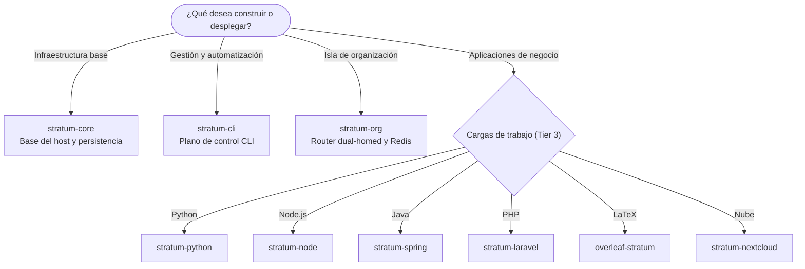
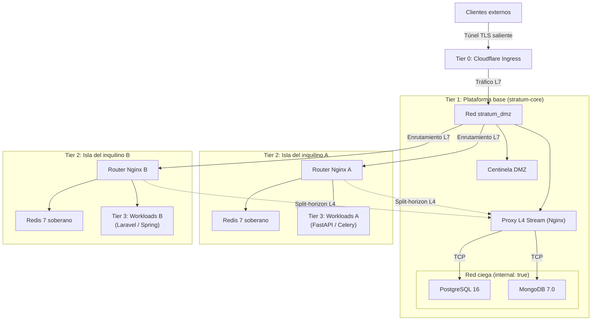
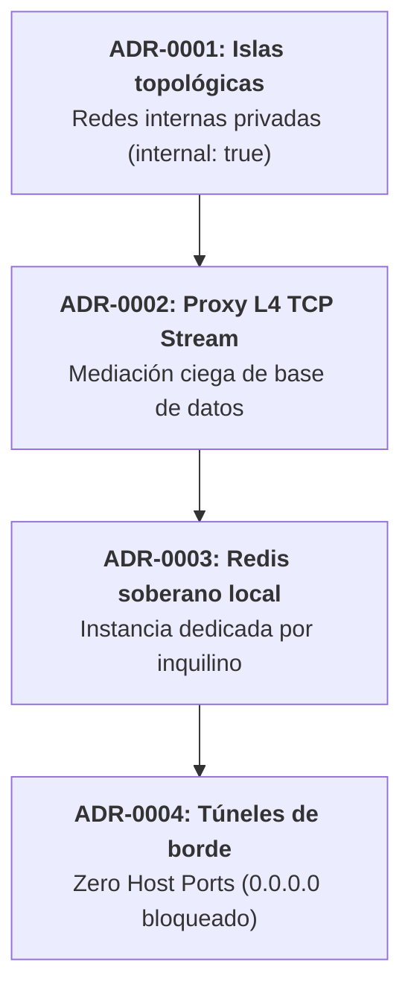
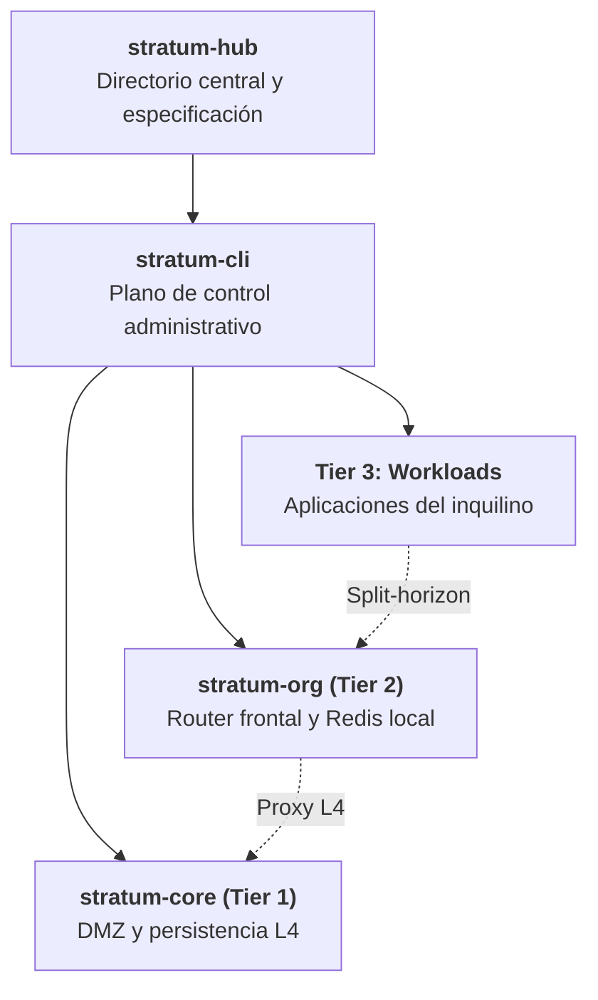

# Stratum
## Arquitectura Soberana Multi-Tenant
### Directorio maestro de componentes · Suite de infraestructura con aislamiento por diseño

[-f59e0b?style=for-the-badge&logo=shield&logoColor=white)](https://www.linkedin.com/in/sandra-puerto/)

### *«Aislamiento por diseño, no por disciplina»*

---

[1. Resumen ejecutivo](#1-resumen-ejecutivo) · [2. Punto de partida](#2-punto-de-partida) · [3. Topología](#3-topología-en-cuatro-tiers) · [4. Repositorios](#4-directorio-de-repositorios) · [5. ADR](#5-decisiones-arquitectónicas-adr) · [6. STRIDE y cumplimiento](#6-modelo-de-amenazas-y-cumplimiento) · [7. Jerarquía](#7-jerarquía-de-módulos) · [8. Adopción](#8-adopción-empresarial-y-soporte) · [9. Gobernanza](#9-autoría-gobernanza-y-licencia)

---

## 1. Resumen ejecutivo

Stratum es una arquitectura de referencia soberana y una suite de ingeniería de contenedores para operar múltiples organizaciones independientes sobre una misma infraestructura física o virtual. Se sustenta en tres principios: aislamiento topológico de red por diseño, mediación ciega de la persistencia y un plano de control administrativo autónomo.

### Problemas que aborda

* **Multi-tenancy lógico en base de datos:** Alojar varias empresas en una base de datos compartida, separadas únicamente por `tenant_id`, traslada el riesgo a cada consulta: un error en una sentencia SQL, una migración fallida o un defecto del ORM pueden exponer información entre clientes. Stratum establece el aislamiento en el kernel y en los espacios de nombres de red (*network namespaces*). La separación no depende de la diligencia humana; es una restricción de la propia infraestructura.
* **Sobrecarga operativa de Kubernetes:** Para un conjunto de entre 2 y 50 organizaciones, un clúster Kubernetes añade costo y complejidad que rara vez se justifican. Stratum ofrece una densidad multi-tenant eficiente, segura y económica sobre hosts Linux estándar.
* **Exposición de puertos en el host:** Stratum aplica la regla Zero Host Ports: ningún contenedor publica puertos en la interfaz del servidor (`0.0.0.0`). Todo el tráfico ingresa mediante túneles cifrados de salida (Cloudflare Zero Trust).

> **Propiedad intelectual:** Conforme a la **Ley 23 de 1982** y a la **Decisión Andina 351 de 1993**, Stratum está registrada como obra científica y técnica inédita ante la **Dirección Nacional de Derecho de Autor (DNDA)** de Colombia. Fue concebida y diseñada por **Sandra Gabriela Puerto Torres (SGPT)**, se distribuye bajo la marca comercial **Isora Cloud Group (ICG)** y se implementó mediante ingeniería agéntica con **Google Antigravity AI** y **DeepSeek**.

---

## 2. Punto de partida

El siguiente diagrama orienta la elección del componente según el objetivo.

### Acceso directo por caso de uso

| Objetivo | Componente | Alcance |
| :--- | :--- | :--- |
| **Red perimetral y persistencia** | [stratum-core](https://github.com/isora-cloud-group/stratum-core) | Red DMZ, túneles Cloudflare y clúster central de persistencia (PostgreSQL 16 / MongoDB 7). |
| **Administración y automatización** | [stratum-cli](https://github.com/isora-cloud-group/stratum-cli) | Orquestador autónomo en Python (`stratum org create`, `stratum db create`, `stratum doctor`). |
| **Aislamiento por organización** | [stratum-org](https://github.com/isora-cloud-group/stratum-org) | Plantilla de isla soberana con enrutador frontal y Redis 7 local dedicado. |
| **Aplicaciones (Tier 3)** | [Python](https://github.com/isora-cloud-group/stratum-python) · [Node.js](https://github.com/isora-cloud-group/stratum-node) · [Java/Spring](https://github.com/isora-cloud-group/stratum-spring) · [PHP/Laravel](https://github.com/isora-cloud-group/stratum-laravel) · [LaTeX/Overleaf](https://github.com/isora-cloud-group/overleaf-stratum) · [Nube/Nextcloud](https://github.com/isora-cloud-group/stratum-nextcloud) | Cargas de trabajo por tecnología. |

---

## 3. Topología en cuatro tiers

---

## 4. Directorio de repositorios

Los módulos de la suite se coordinan bajo la organización [Isora Cloud Group](https://github.com/isora-cloud-group).

| Repositorio | Capa | Descripción | Estado |
| :--- | :--- | :--- | :---: |
| [stratum-hub](https://github.com/isora-cloud-group/stratum-hub) | Directorio central | Punto de entrada institucional: catálogo de integraciones, especificaciones técnicas y ADR. | Producción |
| [stratum-core](https://github.com/isora-cloud-group/stratum-core) | Tier 1 · Plataforma base | Infraestructura perimetral, subred DMZ, proxy de persistencia L4 TCP y bases de datos centrales aisladas. | v2.0.0 |
| [stratum-cli](https://github.com/isora-cloud-group/stratum-cli) | Plano de control | Orquestador CLI en Python puro, sin dependencias en tiempo de ejecución, para aprovisionamiento, rotación criptográfica y auditoría. | v2.0.0 |
| [stratum-org](https://github.com/isora-cloud-group/stratum-org) | Tier 2 · Isla de inquilino | Plantilla de aislamiento soberano: router Nginx dual-homed y Redis 7 dedicado por cliente. | v1.1.0 |
| [stratum-laravel](https://github.com/isora-cloud-group/stratum-laravel) | Tier 3 · Carga de trabajo | PHP 8.4 con Laravel 11/12+, FrankenPHP/Nginx, almacenamiento de solo lectura y ejecución sin privilegios. | v2.1.0 |
| [overleaf-stratum](https://github.com/isora-cloud-group/overleaf-stratum) | Tier 3 · Carga de trabajo | Estudio colaborativo de LaTeX con TeX Live 2026 Scheme-Full, compilación en tmpfs y mitigación de cold starts. | v3.1.0 |
| [stratum-python](https://github.com/isora-cloud-group/stratum-python) | Tier 3 · Carga de trabajo | Plantilla base para Python 3.12+ (FastAPI, Django, Celery) con hardening multi-stage y conexión a persistencia local. | v1.0.0 |
| [stratum-node](https://github.com/isora-cloud-group/stratum-node) | Tier 3 · Carga de trabajo | Plantilla base para Node.js 20/22+ LTS (NestJS, Express, TypeScript) sobre Alpine Linux, con recolección de procesos zombi mediante tini. | v1.0.0 |
| [stratum-spring](https://github.com/isora-cloud-group/stratum-spring) | Tier 3 · Carga de trabajo | Plantilla base para Java 21 LTS y Spring Boot 3.3+, con memoria optimizada para contenedores (`MaxRAMPercentage`). | v1.0.0 |
| [stratum-nextcloud](https://github.com/isora-cloud-group/stratum-nextcloud) | Tier 3 · Carga de trabajo | Suite soberana multi-tenant de colaboración y almacenamiento, con base de datos y Redis propios. | v2.0.0 |

---

## 5. Decisiones arquitectónicas (ADR)

La arquitectura se formaliza en cuatro registros de decisión (*Architectural Decision Records*).

* **ADR-0001 · Islas topológicas frente a puentes planos:** Cada inquilino opera en una red puente dedicada, `stratum_${TENANT_ORG}_internal`, con la directiva `internal: true`. Sus cargas no tienen interfaz en la DMZ ni publican puertos en el host, lo que produce un aislamiento estricto en los espacios de nombres de red.
* **ADR-0002 · Proxy de capa 4 para la persistencia compartida:** Un proxy perimetral Nginx con módulo stream (`stratum-database-nginx`) resuelve nombres de forma dinámica mediante el DNS interno de Docker (`127.0.0.11 valid=10s`) y reutiliza conexiones (`proxy_timeout 1h`). Así, los motores de base de datos nunca se conectan a la red DMZ.
* **ADR-0003 · Redis soberano por inquilino:** Se eliminan los servidores Redis compartidos con bases de datos lógicas. Cada cliente dispone de su propio contenedor, con las siguientes restricciones:
  * Memoria limitada (`--maxmemory 200mb`) y política `allkeys-lru`.
  * Comandos críticos deshabilitados: `CONFIG`, `MODULE`, `DEBUG` y `SHUTDOWN`.
  * Sistema de archivos raíz inmutable (`read_only: true`).
* **ADR-0004 · Túneles de borde autenticados, sin puertos expuestos:** Se suprimen por completo los puertos de entrada en el cortafuegos físico (`0.0.0.0`). El ingreso se canaliza exclusivamente por túneles salientes cifrados de Cloudflare Zero Trust (`cloudflared`).

---

## 6. Modelo de amenazas y cumplimiento

### Modelo STRIDE

Stratum mitiga cada vector de ataque mediante restricciones de infraestructura.

| Categoría | Vector convencional | Mitigación en Stratum |
| :--- | :--- | :--- |
| **Spoofing (suplantación)** | Un inquilino malicioso suplanta la IP interna de otro en una subred compartida. | Redes virtuales aisladas con `internal: true`; los paquetes no pueden enrutarse entre islas. |
| **Tampering (alteración)** | Manipulación no autorizada de tablas en bases de datos multi-tenant compartidas. | Nombres deterministas `org_servicio`, con usuarios y esquemas restringidos bajo mínimo privilegio. |
| **Repudiation (repudio)** | Modificaciones no trazables en rutas web o en la configuración de microservicios. | Registro estructurado en JSON con sellos de tiempo ISO 8601 y control de versiones mediante infraestructura como código (IaC). |
| **Information Disclosure** | Escaneo de puertos internos o fugas cruzadas en canales Redis Pub/Sub globales. | Redis soberano por inquilino y proxy L4 con reenvío split-horizon. |
| **Denial of Service** | La saturación de memoria o CPU de un inquilino compromete al servidor anfitrión. | Contención de recursos con cgroups v2 (`mem_limit`, `cpus`, `pids_limit`) en cada contenedor. |
| **Elevation of Privilege** | Escape de contenedor mediante escalada de privilegios hacia el kernel anfitrión. | `cap_drop: [ALL]`, `security_opt: [no-new-privileges:true]` y ejecución obligatoria con usuarios no-root. |

### Mapeo regulatorio

| Estándar | Control | Cómo lo satisface Stratum |
| :--- | :--- | :--- |
| **ISO/IEC 27001:2022** | A.8.12 · Prevención de fuga de datos | Redes de base de datos ciegas (`internal: true`), sin ruta predeterminada hacia internet. |
| **ISO/IEC 27001:2022** | A.8.20 · Seguridad de redes | Segmentación topológica en cuatro tiers, con interfaces perimetrales y DNS interno restringido. |
| **ISO/IEC 27001:2022** | A.8.24 · Criptografía | Generador de entropía física con HMAC-SHA512 y comunicación de borde cifrada con TLS. |
| **ISO/IEC/IEEE 29148:2018** | Ingeniería de requisitos | Especificación formal de interfaces, hardware mínimo (x86_64/ARM64) y criterios de aceptación. |
| **SOC 2 Type II** | Confidentiality · CC6.1 | Aislamiento estricto de memoria (Redis dedicado) y persistencia independiente por inquilino. |
| **RGPD / GDPR** | Artículo 17 · Derecho de supresión | Desaprovisionamiento atómico y eliminación completa de esquemas y volúmenes, sin interrumpir a terceros. |

---

## 7. Jerarquía de módulos

Los componentes de Stratum se articulan en una jerarquía de dependencias de un solo sentido (ascendente). Las cargas de trabajo consumen servicios sin introducir acoplamientos circulares.

[stratum-hub](https://github.com/isora-cloud-group/stratum-hub) · [stratum-cli](https://github.com/isora-cloud-group/stratum-cli) · [stratum-core](https://github.com/isora-cloud-group/stratum-core) · [stratum-org](https://github.com/isora-cloud-group/stratum-org)

---

## 8. Adopción empresarial y soporte

Para implementar Stratum en la infraestructura privada de una organización, migrar clientes o contratar un despliegue gestionado de nivel corporativo, se ofrecen los siguientes servicios.

* **Servicios gestionados:** Despliegue de infraestructura soberana bare-metal o en nube privada, hardening del kernel Linux y auditoría de aislamiento multi-tenant.
* **Consultoría de arquitectura:** Integración a medida de cargas de trabajo heredadas (*legacy*) en el modelo de islas topológicas.

### Contacto

| Canal | Enlace |
| :--- | :--- |
| **Portal oficial** | [stratum.isora.com.co](https://stratum.isora.com.co/) |
| **Consultas generales y alianzas** | [contact@isora.com.co](mailto:contact@isora.com.co) |
| **Operaciones de seguridad** | [security@isora.com.co](mailto:security@isora.com.co) |
| **Distribuidor comercial** | [Isora Cloud Group](https://isora.com.co/) |

---

## 9. Autoría, gobernanza y licencia

Stratum combina la titularidad exclusiva de la propiedad intelectual con distribución comercial corporativa e ingeniería agéntica.

| Rol | Entidad | Alcance | Perfiles |
| :--- | :--- | :--- | :--- |
| **Titularidad y arquitectura** | **Sandra Gabriela Puerto Torres (SGPT)** | Titular única y exclusiva de los derechos morales y patrimoniales. Concepción de la arquitectura, diseño de controles y dirección técnica. | [GitHub](https://github.com/sandra-puerto) · [LinkedIn](https://www.linkedin.com/in/sandra-puerto/) · [sandrapuerto.com](https://sandrapuerto.com/) |
| **Marca y distribución** | **Isora Cloud Group (ICG)** | Marca comercial, gobernanza de la suite, despliegue gestionado y soporte corporativo. | [isora.com.co](https://isora.com.co/) · [stratum.isora.com.co](https://stratum.isora.com.co/) |
| **Ingeniería agéntica principal** | **Google Antigravity AI Engine** | Implementación del código fuente, arquitectura agéntica de aislamiento, pruebas automatizadas y hardening de seguridad. | [Google DeepMind](https://deepmind.google/) |
| **Síntesis fundacional (v1)** | **DeepSeek** | Prototipado inicial y síntesis arquitectónica de la primera versión conceptual. | [DeepSeek AI](https://deepseek.com/) |

### Registro legal y licencia

* **Propiedad intelectual:** Obra científica y técnica inédita, conforme a la **Ley 23 de 1982** y a la **Decisión Andina 351 de 1993**, ante la **Dirección Nacional de Derecho de Autor (DNDA)** de la República de Colombia. La titularidad exclusiva de los derechos morales y patrimoniales está reservada a nombre de Sandra Gabriela Puerto Torres (SGPT).
* **Licencia:** Código abierto bajo los términos de la **[Apache License, Version 2.0](LICENSE)**.
* **Marcas de terceros:** Docker®, Cloudflare®, Nginx®, PostgreSQL®, MongoDB®, Redis®, Overleaf®, Nextcloud®, Python® y Linux® se mencionan únicamente con fines de identificación técnica, bajo uso legítimo (*nominative fair use*).
