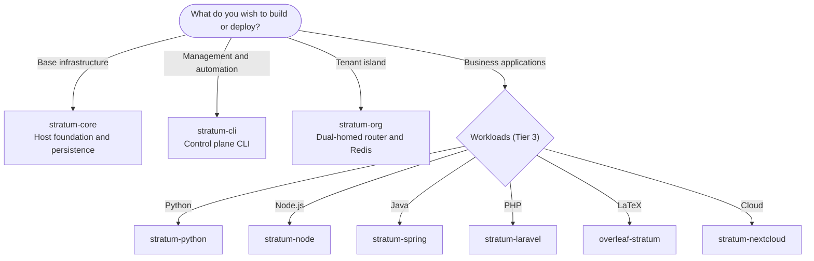
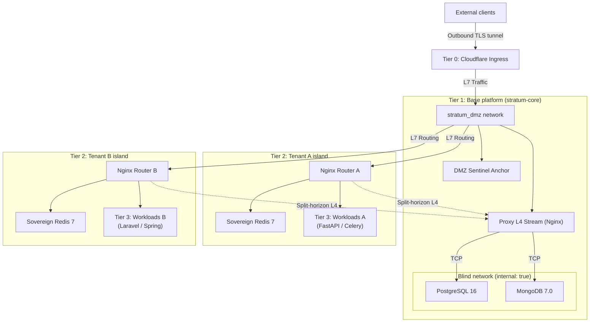
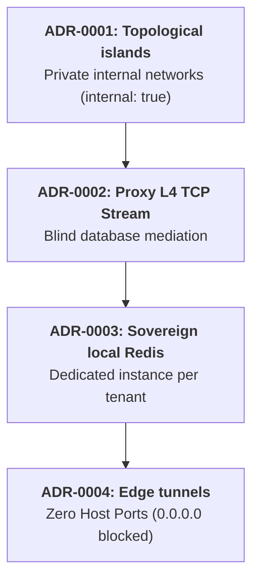
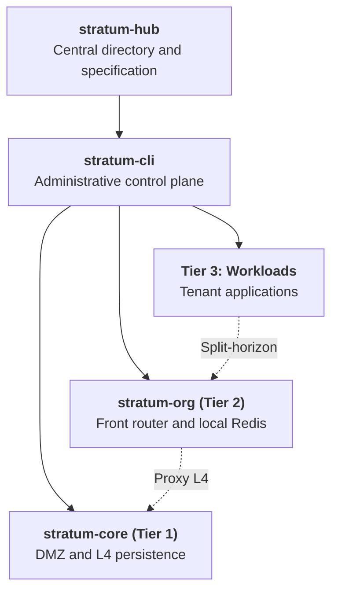

# Stratum
## Sovereign Multi-Tenant Architecture
### Master component directory · Infrastructure suite with isolation by design

### *Isolation by design, not by discipline*

---

[**1. Executive summary**](#1-executive-summary) ·
[**2. Starting point**](#2-starting-point) ·
[**3. Topology**](#3-four-tier-topology) ·
[**4. Repositories**](#4-repository-directory) ·
[**5. ADR**](#5-architectural-decisions-adr) ·
[**6. STRIDE and compliance**](#6-threat-model-and-compliance) ·
[**7. Hierarchy**](#7-module-hierarchy) ·
[**8. Adoption**](#8-enterprise-adoption-and-support) ·
[**9. Governance**](#9-authorship-governance-and-license)

---

## 1. Executive summary

**Stratum** is a sovereign reference architecture and a container engineering suite to operate multiple independent organizations on the same physical or virtual infrastructure. It is based on three principles: topological network isolation by design, blind persistence mediation, and an autonomous administrative control plane.

### Problems it addresses

**Logical multi-tenancy in database.**
Hosting several companies in a shared database, separated solely by `tenant_id`, shifts the risk to each query: an error in an SQL statement, a failed migration, or an ORM bug can expose information between clients. Stratum establishes isolation in the kernel and in network namespaces. Separation does not depend on human diligence; it is a constraint of the infrastructure itself.

**Operational overhead of Kubernetes.**
For a set of between 2 and 50 organizations, a Kubernetes cluster adds cost and complexity that are rarely justified. Stratum offers efficient, secure, and cost-effective multi-tenant density on standard Linux hosts.

**Port exposure on the host.**
Stratum applies the **Zero Host Ports** rule: no container publishes ports on the server interface (`0.0.0.0`). All traffic enters via outbound encrypted tunnels (Cloudflare Zero Trust).

> **Intellectual property.** Pursuant to **Law 23 of 1982** and **Andean Decision 351 of 1993**, Stratum is registered as an **unpublished scientific and technical work** with the **National Directorate of Copyright (DNDA)** of Colombia. It was conceived and designed by **Sandra Gabriela Puerto Torres (SGPT)**, is distributed under the commercial brand **Isora Cloud Group (ICG)**, and was implemented through agentic engineering with **Google Antigravity AI** and **DeepSeek**.

---

## 2. Starting point

The following diagram guides component selection according to the objective.

### Direct access by use case

| Objective | Component | Scope |
| :--- | :--- | :--- |
| Perimeter network and persistence | [stratum-core](https://github.com/isora-cloud-group/stratum-core) | DMZ network, Cloudflare tunnels, and central persistence cluster (PostgreSQL 16 / MongoDB 7). |
| Administration and automation | [stratum-cli](https://github.com/isora-cloud-group/stratum-cli) | Autonomous Python orchestrator (`stratum org create`, `stratum db create`, `stratum doctor`). |
| Isolation by organization | [stratum-org](https://github.com/isora-cloud-group/stratum-org) | Sovereign island template with front router and dedicated local Redis 7. |
| Applications (Tier 3) | [Python](https://github.com/isora-cloud-group/stratum-python) · [Node.js](https://github.com/isora-cloud-group/stratum-node) · [Java/Spring](https://github.com/isora-cloud-group/stratum-spring) · [PHP/Laravel](https://github.com/isora-cloud-group/stratum-laravel) · [LaTeX/Overleaf](https://github.com/isora-cloud-group/overleaf-stratum) · [Cloud/Nextcloud](https://github.com/isora-cloud-group/stratum-nextcloud) | Workloads by technology. |

---

## 3. Four-tier topology

---

## 4. Repository directory

Suite modules are coordinated under the [**Isora Cloud Group**](https://github.com/isora-cloud-group) organization.

| Repository | Layer | Description | Status |
| :--- | :--- | :--- | :---: |
| [`stratum-hub`](https://github.com/isora-cloud-group/stratum-hub) | Central directory | Institutional entry point: integration catalog, technical specifications, and ADR. | Production |
| [`stratum-core`](https://github.com/isora-cloud-group/stratum-core) | Tier 1 · Base platform | Perimeter infrastructure, DMZ subnet, L4 TCP persistence proxy, and isolated central databases. | v2.0.0 |
| [`stratum-cli`](https://github.com/isora-cloud-group/stratum-cli) | Control plane | CLI orchestrator in pure Python, zero runtime dependencies, for provisioning, cryptographic rotation, and auditing. | v2.0.0 |
| [`stratum-org`](https://github.com/isora-cloud-group/stratum-org) | Tier 2 · Tenant island | Sovereign isolation template: dual-homed Nginx router and dedicated Redis 7 per client. | v1.1.0 |
| [`stratum-laravel`](https://github.com/isora-cloud-group/stratum-laravel) | Tier 3 · Workload | PHP 8.4 with Laravel 11/12+, FrankenPHP/Nginx, read-only storage, and unprivileged execution. | v2.1.0 |
| [`overleaf-stratum`](https://github.com/isora-cloud-group/overleaf-stratum) | Tier 3 · Workload | Collaborative LaTeX studio with TeX Live 2026 Scheme-Full, compilation in `tmpfs`, and *cold start* mitigation. | v3.1.0 |
| [`stratum-python`](https://github.com/isora-cloud-group/stratum-python) | Tier 3 · Workload | Base template for Python 3.12+ (FastAPI, Django, Celery) with multi-stage *hardening* and local persistence connection. | v1.0.0 |
| [`stratum-node`](https://github.com/isora-cloud-group/stratum-node) | Tier 3 · Workload | Base template for Node.js 20/22+ LTS (NestJS, Express, TypeScript) on Alpine Linux, with zombie process reaping via tini. | v1.0.0 |
| [`stratum-spring`](https://github.com/isora-cloud-group/stratum-spring) | Tier 3 · Workload | Base template for Java 21 LTS and Spring Boot 3.3+, with memory optimized for containers (`MaxRAMPercentage`). | v1.0.0 |
| [`stratum-nextcloud`](https://github.com/isora-cloud-group/stratum-nextcloud) | Tier 3 · Workload | Sovereign multi-tenant collaboration and storage suite, with dedicated database and Redis. | v2.0.0 |

---

## 5. Architectural decisions (ADR)

The architecture is formalized in four decision records (*Architectural Decision Records*).

**ADR-0001 · Topological islands versus flat bridges.**
Each tenant operates in a dedicated bridge network, `stratum_${TENANT_ORG}_internal`, with the `internal: true` directive. Its workloads have no interface in the DMZ and do not publish ports on the host, which produces strict isolation in network namespaces.

**ADR-0002 · Layer 4 proxy for shared persistence.**
An Nginx perimeter proxy with `stream` module (`stratum-database-nginx`) dynamically resolves names via Docker's internal DNS (`127.0.0.11 valid=10s`) and reuses connections (`proxy_timeout 1h`). Thus, database engines never connect to the DMZ network.

**ADR-0003 · Sovereign Redis per tenant.**
Shared Redis servers with logical databases are eliminated. Each client has its own container, with the following restrictions:

- Memory limited (`--maxmemory 200mb`) and `allkeys-lru` policy.
- Critical commands disabled: `CONFIG`, `MODULE`, `DEBUG`, and `SHUTDOWN`.
- Immutable root filesystem (`read_only: true`).

**ADR-0004 · Authenticated edge tunnels, no exposed ports.**
Inbound ports on the physical firewall (`0.0.0.0`) are completely suppressed. Ingress is channeled exclusively through outbound encrypted tunnels of Cloudflare Zero Trust (`cloudflared`).

---

## 6. Threat model and compliance

### STRIDE model

Stratum mitigates each attack vector through infrastructure constraints.

| Category | Conventional vector | Mitigation in Stratum |
| :--- | :--- | :--- |
| **Spoofing** (impersonation) | A malicious tenant spoofs the internal IP of another on a shared subnet. | Isolated virtual networks with `internal: true`; packets cannot route between islands. |
| **Tampering** (alteration) | Unauthorized manipulation of tables in shared multi-tenant databases. | Deterministic naming `org_service`, with restricted users and schemas under least privilege. |
| **Repudiation** | Untraceable modifications in web routes or microservice configurations. | Structured logging in JSON with ISO 8601 timestamps and version control via Infrastructure as Code (IaC). |
| **Information Disclosure** | Internal port scanning or cross-leaks in global Redis Pub/Sub channels. | Sovereign Redis per tenant and L4 proxy with *split-horizon* forwarding. |
| **Denial of Service** | Memory or CPU saturation of a tenant compromises the host server. | Resource containment with cgroups v2 (`mem_limit`, `cpus`, `pids_limit`) in each container. |
| **Elevation of Privilege** | Container escape via privilege escalation to the host kernel. | `cap_drop: [ALL]`, `security_opt: [no-new-privileges:true]`, and mandatory execution with non-root users. |

### Regulatory mapping

| Standard | Control | How Stratum satisfies it |
| :--- | :--- | :--- |
| **ISO/IEC 27001:2022** | A.8.12 · Data leakage prevention | Blind database networks (`internal: true`), with no default route to the internet. |
| **ISO/IEC 27001:2022** | A.8.20 · Network security | Topological segmentation in four tiers, with perimeter interfaces and restricted internal DNS. |
| **ISO/IEC 27001:2022** | A.8.24 · Cryptography | Physical entropy generator with HMAC-SHA512 and edge communication encrypted with TLS. |
| **ISO/IEC/IEEE 29148:2018** | Requirements engineering | Formal interface specification, minimum hardware (x86_64/ARM64), and acceptance criteria. |
| **SOC 2 Type II** | Confidentiality · CC6.1 | Strict memory isolation (dedicated Redis) and independent persistence per tenant. |
| **RGPD / GDPR** | Article 17 · Right to erasure | Atomic deprovisioning and complete removal of schemas and volumes, without interrupting third parties. |

---

## 7. Module hierarchy

Stratum components articulate in a one-way (bottom-up) dependency hierarchy. Workloads consume services without introducing circular couplings.

[stratum-hub](https://github.com/isora-cloud-group/stratum-hub) · [stratum-cli](https://github.com/isora-cloud-group/stratum-cli) · [stratum-core](https://github.com/isora-cloud-group/stratum-core) · [stratum-org](https://github.com/isora-cloud-group/stratum-org)

---

## 8. Enterprise adoption and support

To deploy Stratum on the private infrastructure of an organization, migrate clients, or contract an enterprise-grade managed deployment, the following services are offered.

**Managed services.** Deployment of sovereign infrastructure on *bare-metal* or in private cloud, Linux kernel *hardening*, and multi-tenant isolation audit.

**Architecture consulting.** Tailored integration of legacy workloads into the topological island model.

### Contact

| Channel | Link |
| :--- | :--- |
| Official portal | [stratum.isora.com.co](https://stratum.isora.com.co) |
| General inquiries and alliances | [contact@isora.com.co](mailto:contact@isora.com.co) |
| Security operations | [security@isora.com.co](mailto:security@isora.com.co) |
| Commercial distributor | [Isora Cloud Group](https://isora.com.co) |

---

## 9. Authorship, governance, and license

Stratum combines exclusive ownership of intellectual property with corporate commercial distribution and agentic engineering.

| Role | Entity | Scope | Profiles |
| :--- | :--- | :--- | :--- |
| **Authorship and architecture** | **Sandra Gabriela Puerto Torres (SGPT)** | Sole and exclusive owner of moral and economic rights. Architecture conception, control design, and technical direction. | [GitHub](https://github.com/sandra-puerto) · [LinkedIn](https://www.linkedin.com/in/sandra-puerto/) · [sandrapuerto.com](https://sandrapuerto.com) |
| **Brand and distribution** | **Isora Cloud Group (ICG)** | Commercial brand, suite governance, managed deployment, and enterprise support. | [isora.com.co](https://isora.com.co) · [stratum.isora.com.co](https://stratum.isora.com.co) |
| **Lead agentic engineering** | **Google Antigravity AI Engine** | Source code implementation, agentic isolation architecture, automated testing, and security *hardening*. | [Google DeepMind](https://deepmind.google) |
| **Foundational synthesis (v1)** | **DeepSeek** | Initial prototyping and architectural synthesis of the first conceptual version. | [DeepSeek AI](https://deepseek.com) |

### Legal registration and license

**Intellectual property.** Unpublished scientific and technical work, pursuant to Law 23 of 1982 and Andean Decision 351 of 1993, with the National Directorate of Copyright (DNDA) of the Republic of Colombia. Sole and exclusive ownership of moral and economic rights is reserved to Sandra Gabriela Puerto Torres (SGPT).

**License.** Open source under the terms of the [Apache License, Version 2.0](LICENSE).

**Third-party trademarks.** Docker®, Cloudflare®, Nginx®, PostgreSQL®, MongoDB®, Redis®, Overleaf®, Nextcloud®, Python®, and Linux® are mentioned solely for technical identification purposes, under nominative fair use.
