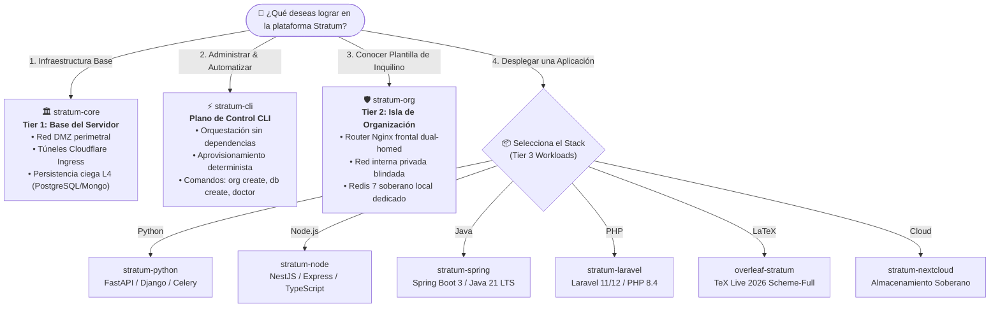
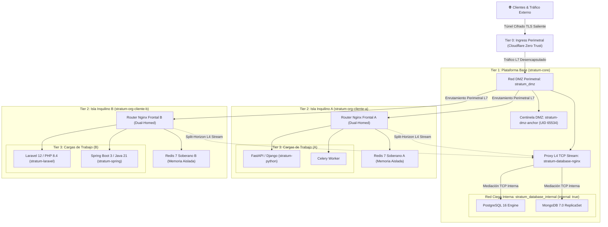
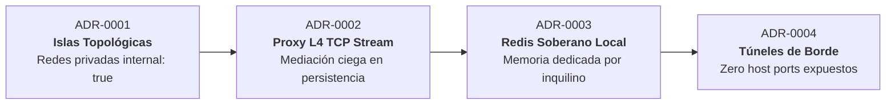
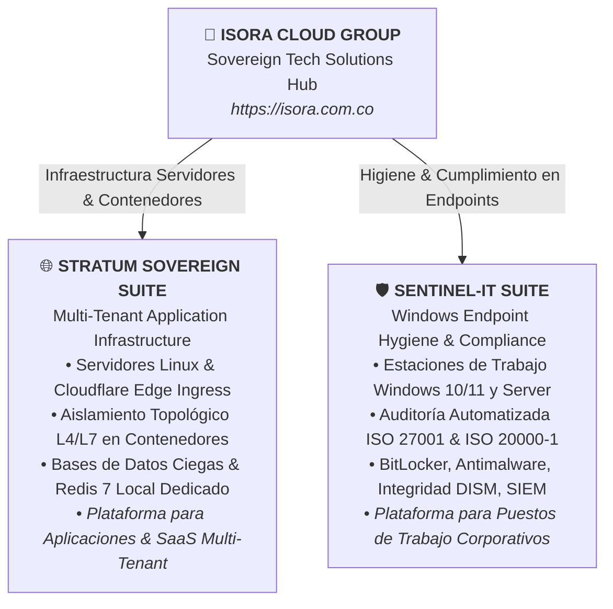

# 🌐 STRATUM SOVEREIGN MULTI-TENANT ARCHITECTURE
## Hub Central de Arquitectura y Directorio Maestro de Componentes
### Enterprise Isolation-by-Design Infrastructure Suite

[-f59e0b?style=for-the-badge&logo=shield&logoColor=white)](https://www.linkedin.com/in/sandra-puerto/)

### *«Aislamiento por diseño, no por disciplina»*
*(“Isolation by design, not by discipline”)*

---

[**1. Resumen Ejecutivo**](#1-resumen-ejecutivo-y-alcance-operativo) •
[**2. ¿Por Dónde Empiezo?**](#2-árbol-de-decisión-por-dónde-empiezo) •
[**3. Topología en 4 Tiers**](#3-topología-de-la-arquitectura-4-tiers) •
[**4. Directorio de Repositorios**](#4-directorio-de-repositorios-del-ecosistema) •
[**5. Decisiones (ADRs)**](#5-decisiones-arquitectónicas-registradas-adrs) •
[**6. STRIDE & Cumplimiento**](#6-modelo-de-amenazas-stride-y-cumplimiento) •
[**7. Ecosistema ICG**](#7-ecosistema-soberano-isora-cloud-group) •
[**8. Servicios & Adopción**](#8-adopción-empresarial-servicios-y-soporte) •
[**9. Autores & Gobernanza**](#9-autores-gobernanza-y-licencia)

---

## 1. Resumen Ejecutivo y Alcance Operativo

**Stratum** es una arquitectura de referencia soberana y suite de ingeniería de contenedores diseñada para operar múltiples organizaciones independientes sobre una misma infraestructura física o virtual, con **aislamiento topológico de red por diseño**, mediación ciega en persistencia y un plano de control administrativo autónomo.

### La Brecha que Resuelve Stratum
1. **Frente al "Multi-Tenancy Lógico" en Base de Datos:**  
   Colocar múltiples empresas en una base de datos compartida discriminada solo por `tenant_id` es una bomba de tiempo operativa. Un descuido en una consulta SQL, una migración fallida o un bug en el ORM exponen datos confidenciales entre clientes. Stratum impone aislamiento en el kernel y en los espacios de nombres de red (*network namespaces*): **el aislamiento no depende de la atención humana, es una restricción física y lógica de la infraestructura.**
2. **Frente a la Sobrecarga de Kubernetes:**  
   Clústeres sobredimensionados introducen costos desorbitados y complejidad operativa innecesaria para albergar entre 2 y 50 organizaciones. Stratum permite una densidad multi-tenant eficiente, segura y de bajo coste sobre hosts Linux estándar.
3. **Frente a Puertos Host Expuestos:**  
   Stratum opera bajo la regla estricta **Zero Host Ports**: ningún contenedor publica puertos directamente en la interfaz del servidor (`0.0.0.0`). Todo el tráfico llega exclusivamente a través de túneles cifrados salientes de borde (Cloudflare Zero Trust).

> **Marco de Propiedad Intelectual:** Conforme a la **Ley 23 de 1982** y la **Decisión Andina 351 de 1993**, Stratum está formalizada como obra técnica ante la **Dirección Nacional de Derecho de Autor (DNDA)** de Colombia, concebida y diseñada por **Sandra Gabriela Puerto Torres (SGPT)**, distribuida bajo la marca comercial **Isora Cloud Group (ICG)** e implementada mediante ingeniería agéntica de **Google Antigravity AI** y **DeepSeek**.

---

## 2. 🧭 Árbol de Decisión: ¿Por Dónde Empiezo?

Utiliza este diagrama interactivo de decisión para orientarte e identificar inmediatamente el repositorio exacto que requieres según tu objetivo:

---

## 3. 🏗️ Topología de la Arquitectura (4 Tiers)

---

## 4. 📦 Directorio de Repositorios del Ecosistema

Todos los módulos de la suite se coordinan institucionalmente bajo la organización [**Isora Cloud Group**](https://github.com/isora-cloud-group):

| Repositorio | Capa / Rol | Descripción Técnica | Estado | Enlace Oficial |
| :--- | :--- | :--- | :---: | :--- |
| **`stratum-hub`** | **Directorio Central** | Punto de entrada institucional, catálogo de integraciones, especificaciones técnicas y ADRs. | Producción | [Ver Repositorio](https://github.com/isora-cloud-group/stratum-hub) |
| **`stratum-core`** | **Tier 1: Core Platform** | Infraestructura perimetral, subred DMZ, proxy de persistencia L4 TCP y bases de datos centrales blindadas. | v2.0.0 | [Ver Repositorio](https://github.com/isora-cloud-group/stratum-core) |
| **`stratum-cli`** | **Plano de Control** | Orquestador administrativo CLI en Python puro con **cero dependencias en runtime** para aprovisionamiento, rotación criptográfica y auditoría. | v2.0.0 | [Ver Repositorio](https://github.com/isora-cloud-group/stratum-cli) |
| **`stratum-org`** | **Tier 2: Tenant Island** | Plantilla de aislamiento soberano de organización, router Nginx dual-homed y Redis 7 dedicado por cliente. | v1.1.0 | [Ver Repositorio](https://github.com/isora-cloud-group/stratum-org) |
| **`stratum-laravel`**| **Tier 3: Workload** | Carga PHP 8.4 con Laravel 11/12+, FrankenPHP/Nginx, almacenamiento read-only y ejecución no privilegiada. | v2.1.0 | [Ver Repositorio](https://github.com/isora-cloud-group/stratum-laravel) |
| **`overleaf-stratum`**| **Tier 3: Workload** | Estudio colaborativo de LaTeX paquetizado con TeX Live 2026 Scheme-Full, compilación en `tmpfs` y mitigación de cold-starts. | v3.1.0 | [Ver Repositorio](https://github.com/isora-cloud-group/overleaf-stratum) |
| **`stratum-python`** | **Tier 3: Workload** | Boilerplate para Python 3.12+ (FastAPI, Django, Celery) con multi-stage hardening y conexión a persistencia local. | v1.0.0 | [Ver Repositorio](https://github.com/isora-cloud-group/stratum-python) |
| **`stratum-node`** | **Tier 3: Workload** | Boilerplate para Node.js 20/22+ LTS (NestJS, Express, TypeScript) en Alpine Linux con recolección de zombies via tini. | v1.0.0 | [Ver Repositorio](https://github.com/isora-cloud-group/stratum-node) |
| **`stratum-spring`** | **Tier 3: Workload** | Boilerplate para Java 21 LTS y Spring Boot 3.3+ con optimización de memoria para contenedores (`MaxRAMPercentage`). | v1.0.0 | [Ver Repositorio](https://github.com/isora-cloud-group/stratum-spring) |
| **`stratum-nextcloud`**| **Tier 3: Workload** | Suite de colaboración y almacenamiento soberano multi-tenant desacoplada en base de datos dedicada y Redis propio. | v2.0.0 | [Ver Repositorio](https://github.com/isora-cloud-group/stratum-nextcloud) |

---

## 5. 📜 Decisiones Arquitectónicas Registradas (ADRs)

La arquitectura de Stratum formaliza cuatro Registros de Decisión Arquitectónica (*Architectural Decision Records*):

1. **ADR-0001 (Aislamiento por Islas Topológicas frente a Puentes Planos):** Cada inquilino opera sobre una red puente virtual dedicada `stratum_${TENANT_ORG}_internal` con la directiva `internal: true`. Las cargas de trabajo no tienen interfaz en la DMZ ni publican puertos en el host, logrando aislamiento matemático en espacios de nombres de red (*network namespaces*).
2. **ADR-0002 (Proxy de Capa 4 para Persistencia Compartida):** Proxy perimetral Nginx con módulo `stream` (`stratum-database-nginx`) con resolución dinámica mediante el DNS interno de Docker (`127.0.0.11 valid=10s`) y reutilización de conexiones (`proxy_timeout 1h`), evitando que los motores de base de datos se conecten a la red DMZ.
3. **ADR-0003 (Instancias Soberanas Locales de Redis por Inquilino):** Eliminación de servidores Redis compartidos mediante bases de datos lógicas. Cada cliente dispone de su propio contenedor Redis con límite estricto de memoria (`--maxmemory 200mb`), política `allkeys-lru`, comandos críticos deshabilitados (`CONFIG`, `MODULE`, `DEBUG`, `SHUTDOWN`) y sistema de archivos raíz inmutable (`read_only: true`).
4. **ADR-0004 (Túneles de Borde Autenticados con Cero Puertos Expuestos):** Supresión total de puertos de entrada en el cortafuegos físico (`0.0.0.0`). El ingreso se canaliza exclusivamente a través de túneles salientes cifrados Cloudflare Zero Trust (`cloudflared`).

---

## 6. 🛡️ Modelo de Amenazas STRIDE y Cumplimiento

Stratum mitiga los vectores de ataque mediante restricciones de infraestructura:

| Categoría STRIDE | Vector de Amenaza Convencional | Mitigación Topológica en Stratum |
| :--- | :--- | :--- |
| **Spoofing (Suplantación)** | Inquilino malicioso suplanta IP interna de otro inquilino en la subred compartida. | Redes virtuales aisladas con `internal: true`; los paquetes no pueden enrutarse entre islas de inquilino. |
| **Tampering (Alteración)** | Manipulación no autorizada de tablas en bases de datos multi-tenant compartidas. | Nombres deterministas `org_servicio` con usuarios y esquemas restringidos bajo mínimo privilegio. |
| **Repudiation (Repudio)** | Modificaciones no trazables en rutas web o configuración de microservicios. | Registro estructurado JSON con sellos de tiempo ISO 8601 y control de versiones mediante Infraestructura como Código (IaC). |
| **Information Disclosure** | Escaneo de puertos internos o fugas cruzadas en canales Redis Pub/Sub globales. | Instancia local soberana de Redis por inquilino y proxy L4 con reenvío split-horizon. |
| **Denial of Service (DoS)** | Saturación de memoria o CPU por un inquilino compromete el servidor anfitrión. | Contención estricta de recursos mediante cgroups v2 (`mem_limit`, `cpus`, `pids_limit`) en cada contenedor. |
| **Elevation of Privilege** | Fuga de contenedor mediante escalada de privilegios hacia el kernel anfitrión. | `cap_drop: [ALL]`, `security_opt: [no-new-privileges:true]` y ejecución obligatoria bajo usuarios no-root. |

### Mapeo Regulatorio Internacional

| Estándar | Control / Cláusula | Cómo lo Garantiza Stratum |
| :--- | :--- | :--- |
| **ISO/IEC 27001:2022** | **A.8.12** (Fuga de Datos) | Redes de base de datos ciegas (`internal: true`) sin ruta predeterminada de salida a internet. |
| **ISO/IEC 27001:2022** | **A.8.20** (Seguridad en Redes) | Segmentación topológica en 4 Tiers con interfaces perimetrales y DNS interno restringido. |
| **ISO/IEC 27001:2022** | **A.8.24** (Criptografía) | Generador de entropía física con HMAC-SHA512 y comunicación de borde cifrada TLS. |
| **ISO/IEC/IEEE 29148:2018** | Requisitos de Ingeniería | Especificación formal de interfaces, hardware mínimo (x86_64/ARM64) y criterios de aceptación. |
| **SOC 2 Type II** | **Confidentiality / CC6.1** | Aislamiento estricto de memoria (Redis dedicado) y persistencia independiente por inquilino. |
| **RGPD / GDPR** | **Artículo 17** (Derecho al Olvido) | Desaprovisionamiento atómico y eliminación completa de esquemas y volúmenes sin downtime de terceros. |

---

## 7. 🌐 Ecosistema Soberano Isora Cloud Group

Stratum forma parte de la suite tecnológica soberana operada por **Isora Cloud Group**, donde la infraestructura de servidores y la seguridad de endpoints se articulan de forma complementaria:

---

## 8. 💼 Adopción Empresarial, Servicios y Soporte

¿Deseas implementar Stratum en la infraestructura privada de tu organización, migrar clientes o requieres despliegue gestionado de grado corporativo?

* **Servicios Gestionados:** Despliegue de infraestructura soberana bare-metal o en nube privada, hardening de kernel Linux y auditoría de aislamiento multi-tenant.
* **Consultoría de Arquitectura:** Integración a medida de cargas de trabajo heredadas (*legacy*) en el modelo de islas topológicas.
* **Soporte & Contacto Oficial:**
  * **Portal Oficial:** [https://stratum.isora.com.co](https://stratum.isora.com.co)
  * **Consultas Generales y Alianzas:** [contact@isora.com.co](mailto:contact@isora.com.co)
  * **Operaciones de Seguridad:** [security@isora.com.co](mailto:security@isora.com.co)
  * **Distribuidor Comercial:** [Isora Cloud Group](https://isora.com.co)

---

## 9. 👥 Autores, Gobernanza y Licencia

Stratum se rige bajo un modelo de gobernanza que combina titularidad exclusiva de propiedad intelectual con distribución comercial corporativa e ingeniería agéntica de vanguardia:

| Rol | Entidad / Contribuyente | Alcance y Función | Perfiles y Contacto |
| :--- | :--- | :--- | :--- |
| **Copyright & Arquitectura** | **Sandra Gabriela Puerto Torres (SGPT)** | Titular única y exclusiva de los derechos morales y patrimoniales. Concepción de arquitectura, diseño de controles y dirección técnica. | [GitHub: @sandra-puerto](https://github.com/sandra-puerto) · [LinkedIn](https://www.linkedin.com/in/sandra-puerto/) · [sandrapuerto.com](https://sandrapuerto.com) |
| **Marca Comercial & Distribución** | **Isora Cloud Group (ICG)** | Marca comercial paraguas, gobernanza de la suite, despliegue gestionado y soporte corporativo. | [isora.com.co](https://isora.com.co) · [stratum.isora.com.co](https://stratum.isora.com.co) |
| **Ingeniería Agéntica Principal** | **Google Antigravity AI Engine** | Implementación de código fuente, arquitectura agéntica de aislamiento, suites de pruebas automatizadas y hardening de seguridad. | [Google DeepMind](https://deepmind.google) |
| **Síntesis Fundacional v1** | **DeepSeek** | Prototipado inicial y síntesis arquitectónica en la primera versión conceptual de la suite. | [DeepSeek AI](https://deepseek.com) |

---

### Registro Legal y Licencia

* **Propiedad Intelectual:** Obra Científica y Técnica registrada conforme a la **Ley 23 de 1982** y la **Decisión Andina 351 de 1993** ante la **Dirección Nacional de Derecho de Autor (DNDA)** de la República de Colombia.
* **Licencia de Código Abierto:** Distribuido bajo los términos de la **[Apache License, Version 2.0 (Apache-2.0)](LICENSE)**.
* **Aviso de Marcas Nominativas:** Todos los nombres de productos y marcas de terceros (**Docker®**, **Cloudflare®**, **Nginx®**, **PostgreSQL®**, **MongoDB®**, **Redis®**, **Overleaf®**, **Nextcloud®**, **Python®**, **Linux®**) se mencionan únicamente con fines de identificación técnica bajo uso legítimo (*nominative fair use*).
